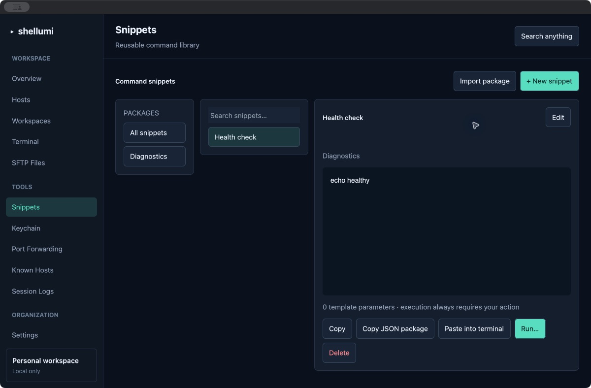
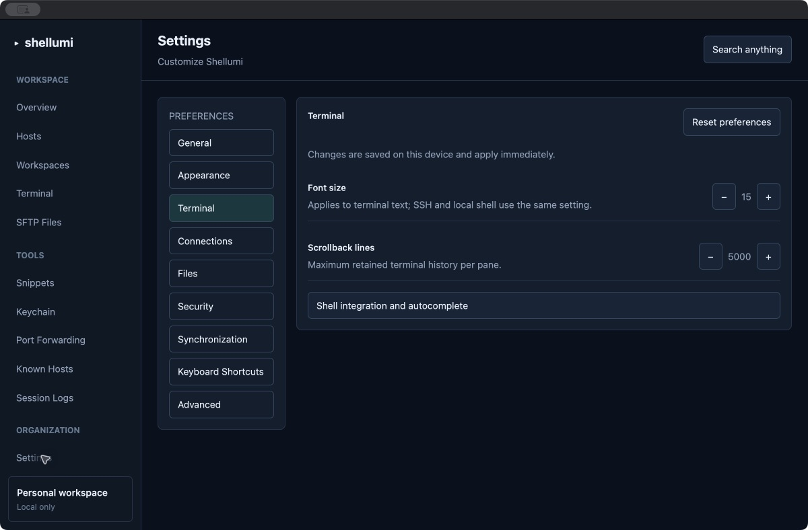

# Shellumi

<p align="center">
  
</p>

**A free, open-source, local-first SSH client and infrastructure workspace.**
Shellumi is built in Rust with a native GPUI interface and a local Turso database.
It aims to provide an alternative to Termius without mandatory accounts,
telemetry, subscriptions, or cloud storage requirements. Licensed under MIT.

**Current milestone: `v0.0.1-alpha`.** This is an early testing release. The
macOS desktop has been exercised locally; Linux and Windows remain target
platforms requiring runtime validation. Review the limitations below before
using Shellumi for administration.

## App screenshots

These are captures of the running macOS development app using an isolated test
database, rather than images from the design prototype.

**Snippet library** — saved commands, tags, script previews and terminal actions.



**Settings** — local preferences, including terminal font size and scrollback.



## What works in this alpha

| Area | Available functionality |
| --- | --- |
| Hosts | Create, edit, delete, search, group filtering, selected-host inspector, jump-host settings, group defaults, and clipboard OpenSSH config import/export. |
| SSH | System OpenSSH sessions inside the desktop terminal, explicit unknown-host confirmation, changed-key rejection, agent forwarding disabled by default, and jump-host arguments. Authentication uses the system SSH config, agent and interactive prompts. |
| Terminal | Local shells and remote sessions, tabs, independent split panes, viewport-based PTY resizing, wheel scrollback, search, clipboard paste, ANSI colors and attributes, and opt-in session recording. |
| Snippets | Create/edit multi-line scripts, tags and live search, template parameters, deletion confirmation, clipboard JSON package import/export, and explicit paste/run actions in an existing terminal. |
| Workspaces | Create, rename/edit, duplicate, delete and reopen named local/SSH session layouts, including single, vertical, horizontal and grid layouts. Opening starts new sessions. |
| Settings | Persistent interface/terminal font sizes, scrollback limit, startup screen and hidden-file preference, plus security information, shell integration tools and diagnostics. |
| SSH identities and trust | Inspect public SSH keys and fingerprints, generate keys with interactive `ssh-keygen`, load identities with `ssh-add`, inspect `known_hosts`, and explicitly revoke trust records. |
| Port forwarding | Save/edit tunnel rules and select their SSH host; start real OpenSSH tunnel sessions and stop them by closing their session. Traffic counters are not measured. |
| Files | Browse real local directories and open live system SFTP terminal sessions for remote file operations. |
| Backups | Export encrypted local vault backups and restore them transactionally; wrong-passphrase errors roll back changes. Existing export files are not overwritten. |
| Other local records | Vault membership, provider inventory and recording managers expose existing local data operations. These do not establish network sharing or cloud connections. |
| CLI | Host/group/snippet/workspace management, OpenSSH dispatch, import/export, encrypted vault operations and diagnostics. |

See [GUI implementation status](docs/GUI_STATUS.md) for screen-by-screen details,
[the feature matrix](docs/FEATURE_MATRIX.md) for scope, and
[the roadmap](docs/ROADMAP.md) for remaining work.

## Install and launch

Download an asset matching your operating system and CPU from
[GitHub Releases](https://github.com/MJKhaani/Shellumi/releases). Tag builds run
through GitHub Actions; an asset is available only after its build succeeds.
Alpha tags are published as prereleases. The local macOS build is unsigned and
not notarized.

On macOS, extract the app archive or open the disk image and launch
`Shellumi.app`. Quit an older running copy before testing a newer build.
The app uses the system OpenSSH tools; a local terminal also requires a shell.

**No database or storage-path configuration is required.** Shellumi creates its
database and parent directories on first launch:

| Platform | Default database |
| --- | --- |
| macOS | `~/Library/Application Support/Shellumi/shellumi.db` |
| Windows | `%APPDATA%\Shellumi\shellumi.db` |
| Linux | `$XDG_DATA_HOME/Shellumi/shellumi.db`, falling back to `~/.local/share/Shellumi/shellumi.db` |

Display/navigation preferences are stored beside the database in
`shellumi.preferences.json`. Credentials and backup passphrases are not stored
in that preferences file or in host metadata fields. Do not put passwords,
private keys or tokens into host names, tags or reusable command templates.

An optional database override is available for testing:

```sh
shellumi-app --hosts ./hosts.db
```

## Build from source

Install a stable Rust toolchain and the native dependencies needed by
[GPUI](https://github.com/zed-industries/zed/tree/main/crates/gpui). The workspace
uses Rust 2021 and pins GPUI 0.2.2 with a committed Cargo lockfile.

- **macOS:** Full Xcode with a selected developer directory and working Metal
  compiler. Verify `xcrun --find metal`; Command Line Tools alone may be insufficient.
- **Linux:** C/C++ tools, `pkg-config`, font libraries, Wayland/X11/XKB libraries
  and OpenSSL development packages. The release workflow records the Ubuntu build dependencies.
- **Windows:** Rust MSVC toolchain and Visual Studio C++ build tools.

```sh
cargo run --locked -p shellumi-app
```

Build an optimized desktop binary:

```sh
cargo build --locked --release -p shellumi-app
```

The [release workflow](.github/workflows/release.yml) builds Linux x86_64,
Windows x86_64, macOS Apple Silicon and macOS Intel assets on tag pushes.
Release artifacts include SHA-256 checksums and a Cargo dependency metadata
manifest. Packaging definitions do not establish that every platform has been
runtime-tested.

## CLI examples

The CLI currently takes an explicit database path. Use the same database as the
desktop when you want both to manage the same records.

```sh
cargo run --locked -p shellumi-cli -- ./hosts.db add "Web server" example.org alice 22 --group Production --tags web
cargo run --locked -p shellumi-cli -- ./hosts.db list
cargo run --locked -p shellumi-cli -- ./hosts.db connect 1
cargo run --locked -p shellumi-cli -- ./hosts.db quick-connect alice@example.org:2222
cargo run --locked -p shellumi-cli -- ./hosts.db import-ssh-config ~/.ssh/config
cargo run --locked -p shellumi-cli -- ./hosts.db export-ssh-config
```

The desktop provides masked passphrase dialogs for encrypted backup operations.
Keep backup files and their passphrases separately; a lost passphrase cannot be recovered.

Native credential storage is used by default. An optional encrypted credential
fallback requires `SHELLUMI_CREDENTIAL_VAULT_PASSPHRASE` (at least 12 characters);
`SHELLUMI_VAULT_PATH` may select an absolute vault file path. Without a configured
fallback key, native-store failures are reported rather than silently using a
shared encryption key. Existing legacy fallback files are not automatically migrated.
Drive sync requires an externally supplied OAuth token and an explicit
`SHELLUMI_VAULT_PASSPHRASE`; there is no default sync encryption key.

## Connect with a saved identity

Create an identity using the CLI against the same database shown in desktop
Settings → Storage. For example, to use a private key (no secret in the command):

```sh
cargo run --locked -p shellumi-cli -- /path/to/shellumi.db identity add "Production" --username deploy --auth publickey --key-path /path/to/id_ed25519
```

In **Hosts → Edit host → Connection identity**, click **Refresh identities** and
select the identity, then save. **Group settings** can supply an inherited identity;
a host's explicit selection takes precedence. Selecting the inherit/default row
clears the explicit binding. The selected identity's username takes precedence
over the saved host username. Host edits preserve the binding.

Saved SSH sessions, SFTP terminals, graphical SFTP operations, restored workspace
hosts, and tunnels use the same background connection resolver. Private-key and
certificate paths are passed as separate arguments; agent identities use OpenSSH's
agent authentication. Quick Connect has no saved identity and uses OpenSSH defaults.

Password and encrypted-key identities can reference credentials using
`keychain://service/account` or `env://VARIABLE` metadata. The app's separate
OpenSSH askpass helper resolves the reference only for the matching target's
password prompt or selected key's passphrase prompt. It never scans terminal
output, stores a plaintext credential, or adds a secret to command arguments.
Secret-assisted connections require an **already trusted host key**. Establish
trust with a normal interactive SSH connection first, after verifying the server
fingerprint. Unknown/changed keys fail closed. MFA and interactive identities
remain manual; the helper refuses unrecognized prompts, including localized or
alias-rewritten prompts that do not match the selected target. Jump-host
credentials need their own OpenSSH/agent configuration. Native credential access
can require an OS unlock/permission dialog.

## Verification and limitations

The local macOS workspace suite passed **301 automated tests**, with two
real-server tests opt-in. The self-contained SSH/SFTP acceptance test also passed
separately; see [the test guide](docs/development/ssh-integration.md). Local macOS
GUI checks covered snippet creation, workspace saving and shell launch, preference
changes, long terminal output, scrolling and split sizing.

```sh
cargo fmt --all -- --check
cargo clippy --locked --offline --workspace --all-targets -- -D warnings
cargo test --locked --offline --workspace
```

Some diagnostics integration tests need permission to bind a loopback socket.
Offline builds require dependencies to have been fetched beforehand.

Remaining limitations include:

- The graphical SFTP transport passed isolated real-server encrypted-key,
  listing, transfer, reconnect and host-key rejection tests. GUI interaction,
  password/MFA, cancellation and atomic destination replacement remain to be
  verified or implemented; failed transfers can leave partial destination data.
- Drive still needs real-account acceptance. Authorization requires an externally
  supplied OAuth token; there is no complete account setup flow.
- Authenticated cloud inventory discovery and network collaboration remain unconnected.
- Theme/language switching, launch-at-login integration, screen-reader support,
  and the full design-prototype dialog catalog are not complete.
- Windows/Linux credential adapters exist but require real-platform verification.
  Saved identity creation/editing remains CLI-driven; graphical selection is available.
- Automatic startup-command execution is disabled until authentication readiness
  can be established safely.
- Mobile FFI and native examples are prototypes, not released mobile clients.

The system SSH/SFTP clients retain their host-key checks. Native macOS Keychain
and encrypted file-store backends exist, but reusable credential behavior needs
broader integration testing. Turso Database is pre-1.0; keep independent backups.
See the [threat model](docs/security/threat-model.md) for security boundaries.

## Project layout

```text
crates/shellumi-app/       Native GPUI desktop, pages and editors
crates/shellumi-core/      UI-independent domain, validation and crypto models
crates/shellumi-terminal/  Terminal emulator, PTY manager and recording engine
crates/shellumi-storage/   Async local Turso operations, migrations and preferences
crates/shellumi-cli/       Command-line management and connection dispatch
resources/                Logo, screenshots and bundled licenses
docs/                     Architecture, progress, roadmap and threat model
packaging/                Desktop and mobile packaging definitions
.github/workflows/        CI and tag-triggered release builds
```

[PROJECT.md](PROJECT.md) contains the long-term requirements. Its feature list is
the target scope, not a claim that every capability is implemented.
