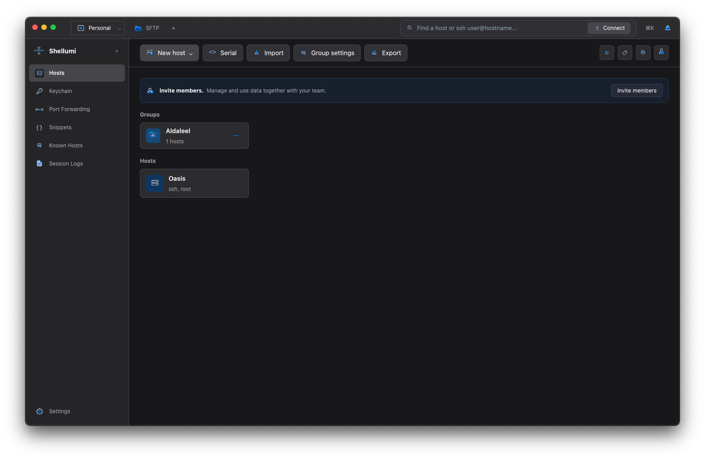

<div align="center">


# Shellumi

**A free, open-source, local-first SSH client and remote infrastructure manager built in Rust with GPUI.**

[](https://github.com/MJKhaani/Shellumi/releases/tag/v0.0.8-alpha)
[](LICENSE)
[](https://github.com/MJKhaani/Shellumi/actions/workflows/ci.yml)
[](Cargo.toml)

[Getting Started](docs/getting-started/README.md) · [User Guide](docs/user-guide/README.md) · [Architecture](docs/architecture/README.md) · [Security](docs/security/README.md) · [Feature Matrix](docs/reference/feature-matrix.md)

</div>

---

Shellumi gives engineers a fast, GPU-accelerated workspace for managing SSH, SFTP, Mosh, RDP, VNC, Telnet, Serial, and local terminal sessions without mandatory cloud accounts, telemetry, or paywalls.

<div align="center">
  
  <br>
  <sub>Shellumi desktop interface on macOS showing vault switcher, host inventory, groups, and Quick Connect.</sub>
</div>

---

## Key Capabilities

<table>
  <tr>
    <td width="50%" valign="top">
       <strong>GPU-Accelerated Terminal & PTY</strong><br>
      VT/ANSI emulator with split panes, broadcast input, scrollback search, Asciicast v2 session recording, and reusable command snippets.
    </td>
    <td width="50%" valign="top">
       <strong>Dual-Pane SFTP Browser</strong><br>
      RFC SFTP v3 over SSH supporting local/remote transfers, drag-and-drop, staged atomic uploads, permissions editing, and remote text editing.
    </td>
  </tr>
  <tr>
    <td width="50%" valign="top">
       <strong>Native RDP & VNC</strong><br>
      Pure-Rust IronRDP and RFB VNC engines with dynamic display resizing (<code>MS-RDPEDISP</code>), clipboard/file sync, audio/mic, drive redirection, and live telemetry.
    </td>
    <td width="50%" valign="top">
       <strong>Encrypted Isolated Vaults</strong><br>
      Separate per-vault AES-256-GCM encrypted Turso databases, Argon2id key wrapping, OS credential-store integration, and multi-window vault isolation.
    </td>
  </tr>
  <tr>
    <td width="50%" valign="top">
       <strong>Unified Inspector & Credentials</strong><br>
      Single-inspector workflow for hosts, groups, reusable identities, tunnels, snippets, workspaces, and inline credential creation with Keep/Replace/Remove safety.
    </td>
    <td width="50%" valign="top">
       <strong>Flexible Operating Modes</strong><br>
      Run 100% offline locally, sync personal vaults via client-side encrypted Google Drive, or connect to self-hosted <a href="https://github.com/MJKhaani/Shellumi-Server">Shellumi Server</a>.
    </td>
  </tr>
</table>

---

## Supported Protocols

| Protocol | Default Port | Engine / Transport | Authentication & Highlights |
| :--- | :--- | :--- | :--- |
|  **SSH** | `22` | System OpenSSH + PTY + Askpass | Keys, certificates, passwords, agent, jump hosts, strict host-key checks |
|  **SFTP** | `22` | `ssh -s sftp` (SFTP v3 codec) | Dual-pane transfers, staged atomic publish, remote editing |
|  **Mosh** | `22` (SSH bootstrap) | System `mosh` + Askpass | Mobile/roaming UDP sessions with fail-closed askpass propagation |
|  **RDP** | `3389` | Embedded IronRDP (Rust) | NLA/CredSSP, TLS TOFU pinning, dynamic resize, CLIPRDR, RDPSND, RDPDR, MS-RDPEAI |
|  **VNC** | `5900` | Native RFB client (Rust) | RFB 3.3/3.7/3.8, VncAuth, Tight/ZRLE/Hextile/CopyRect/Raw, clipboard |
|  **Tunnels** | `22` | OpenSSH `-L` / `-R` / `-D` | Local, remote, and dynamic SOCKS forwarding |
|  **Serial / Telnet / Local** | `—` / `23` | Local PTY / `screen` / `telnet` | Local shell, serial devices, and cleartext-warned Telnet |

See [Protocol Capabilities](docs/reference/protocol-capabilities.md) for the complete capability matrix.

---

## Operating Modes

| Capability | Standalone (Local) | Google Drive Sync | Shellumi Server |
| :--- | :--- | :--- | :--- |
| **Local encrypted vault** | Yes (`vaults/*.db`) | Yes (`vaults/*.db`) | Yes (`vaults/*.db`) |
| **Offline operation** | Full | Full (queues local changes) | Full (reconciles on reconnect) |
| **Cloud synchronization** | None | Personal E2EE (`drive.appdata`) | E2EE server sync & delta feed |
| **Server enrollment** | Not required | Not required | Ed25519 + X25519 device enrollment |
| **Team sharing & collab** | Local-only | No | Shared vaults, roles, E2EE terminal relay |
| **Backup & restore** | Encrypted local export/import | Encrypted Drive snapshots + local | Server snapshots + local export |

See [Synchronization Overview](docs/synchronization/README.md) for details.

---

## Platform Support & Verification Status

| Platform | Target Architectures | CI Build & Unit Tests | Native Interactive GUI Acceptance |
| :--- | :--- | :--- | :--- |
|  **macOS** | `aarch64`, `x86_64` | **PASS** (`.dmg` + binaries) | Exercised locally on macOS |
|  **Linux** | `x86_64` | **PASS** (`.deb` + `Terminal=false` verified) | **NOT TESTED** |
|  **Windows** | `x86_64` | **PASS** (`.zip` + PE `WINDOWS_GUI` verified) | **NOT TESTED** |

> [!NOTE]
> Cross-platform CI verifies compilation, linting, automated tests, Linux `.desktop` validation, and Windows PE subsystems. Interactive desktop testing on native Windows and Linux hosts and live acceptance against external RDP/VNC/Mosh servers remain open (`NOT TESTED`). See [Verification Status](docs/qa/verification-status.md).

---

## Installation & Quick Start

1. Download the latest release for your OS from [GitHub Releases](https://github.com/MJKhaani/Shellumi/releases/tag/v0.0.8-alpha) (macOS `.dmg`, Linux `.deb`, Windows `.zip`, or standalone `shellumi-app` / `shellumi-cli` binaries).
2. Follow [Installation](docs/getting-started/installation.md) and [First Launch](docs/getting-started/first-launch.md) to initialize your encrypted default vault.
3. Follow [Quick Start](docs/getting-started/quick-start.md) to add your first host and connect.

### Build from Source

```sh
git clone https://github.com/MJKhaani/Shellumi.git
cd Shellumi
cargo build --locked --release -p shellumi-app -p shellumi-cli
```

See [Build and Run](docs/development/build-and-run.md) for platform system dependencies.

---

## Documentation Map

| Section | Description |
| :--- | :--- |
| [**Getting Started**](docs/getting-started/README.md) | Installation, system requirements, first-launch wizard, and quick start |
| [**User Guide**](docs/user-guide/README.md) | Hosts, identities, terminal, SFTP, RDP/VNC, tunnels, snippets, vaults, settings |
| [**Synchronization**](docs/synchronization/README.md) | Standalone, Google Drive, Shellumi Server, backups, conflicts, object IDs |
| [**Architecture**](docs/architecture/README.md) | 8-crate workspace, lifecycle, connection engine, Turso storage, RD engine |
| [**Security**](docs/security/README.md) | Threat model, Argon2id/AES-256-GCM cryptography, credential stores, limits |
| [**Design Guidelines**](docs/design/README.md) | GPUI design system, unified Inspector, responsive layout, icon system |
| [**Development**](docs/development/README.md) | Environment setup, coding standards, logging, testing, CI/CD, releases |
| [**Reference**](docs/reference/README.md) | Feature matrix, protocol capabilities, shortcuts, config, env vars, CLI |
| [**QA & Verification**](docs/qa/README.md) | Test strategy, acceptance matrix, CI baseline (`45903344785`), native status |
| [**Project & Roadmap**](docs/project/README.md) | Product requirements, forward roadmap, known issues, archive |

---

## Contributing, Security & License

- **Contributing:** Read [`CONTRIBUTING.md`](CONTRIBUTING.md) and [`AGENTS.md`](AGENTS.md).
- **Security Reporting:** See [`SECURITY.md`](SECURITY.md) — please report vulnerabilities privately.
- **License:** MIT License — see [`LICENSE`](LICENSE).
