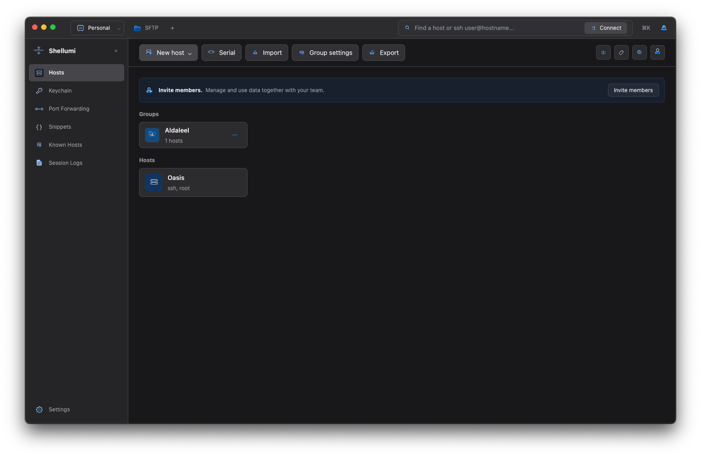

# Shellumi

<p align="center">
  
</p>

<h1 align="center">Shellumi</h1>

<p align="center">
  <strong>A free, open-source, local-first SSH client and remote infrastructure manager.</strong><br>
  Built with native Rust, GPUI, and local Turso SQLite storage.
</p>

<p align="center">
  <a href="https://github.com/MJKhaani/Shellumi/releases"></a>
  <a href="LICENSE"></a>
  
  
  
  
</p>

---

Shellumi is a modern, native alternative to Termius designed from the ground up for developers, sysadmins, and infrastructure engineers. It requires **no mandatory cloud accounts, no subscriptions, no telemetry, and no cloud locks**. Your data remains under your control; optional synchronization uses your own Google Drive account or, once implemented, your self-hosted Shellumi Server.

Shellumi is designed for two modes: **offline local**, with optional encrypted personal synchronization directly through Google Drive; and **online self-hosted**, using [Shellumi Server](https://github.com/MJKhaani/Shellumi-Server) for synchronization, vault sharing, and collaboration. Server integration is planned and is not yet available in this app. Google Drive integration is initial and still requires real-account acceptance testing. See the [feature matrix](docs/FEATURE_MATRIX.md) for current status.

The planned vault model lets users create **local** vaults or **remote** vaults linked to self-hosted servers. Multiple remote vaults may use different servers, and multiple windows in one app instance can each work in a different vault, keeping company data and credentials separate. These vault isolation and multi-window capabilities are not yet implemented or verified.

The planned default local vault will hold the user's own data and an encrypted, synchronized directory of other vaults, without their contents. Remote vaults are planned to keep separate encrypted offline caches. Vault encryption, directory synchronization and remote caches are not yet implemented; current local metadata storage is not encrypted at rest.

**Current milestone: `v0.0.7-alpha`.** This release delivers a fully redesigned interface, complete dual-pane graphical SFTP file manager with recursive directory transfers and macOS folder MIME iconography, uniform pinned action bars, slide-over group inspectors, and advanced host filtering.

---

## Application Screenshot

A capture of the running macOS desktop application:



---

## Key Features

### 🖥️ Native GPUI Desktop Engine
- **Hardware-Accelerated UI:** Powered by Zed's GPUI framework (Metal on macOS, Vulkan on Linux, DirectX on Windows) delivering 60+ FPS responsiveness with negligible CPU overhead.
- **Unified Interface Layout:** Pinned 56px action bars aligned flush across every page (`Hosts`, `Keychain`, `Port Forwarding`, `Snippets`, `Known Hosts`, `Session Logs`, `Settings`) eliminating vertical jitter.
- **Dark Mode by Design:** Carefully calibrated macOS Dark palette with deep contrast surfaces, subtle 1px dividers, and high-DPI typography.

### 📂 Dual-Pane Graphical SFTP Manager
- **All 4 Transfer Scenarios:** Fully supports Local-to-Local, Local-to-Remote, Remote-to-Local, and Remote-to-Remote transfers.
- **Platform Folder MIME Icons:** Folder breadcrumbs and table rows dynamically resolve platform folder icons (`Documents`, `Downloads`, `Desktop`, `Movies`, `Music`, `Pictures`, `Applications`, `Public`).
- **Interactive macOS Breadcrumbs:** Navigable path segments with history back/forward controls (`<` and `>`), detailed columns (Name, Permissions, Date Modified, Size, Kind), and natural parent navigation (`..`).
- **Recursive Directory Transfer:** Multi-item selection, batch copying, and recursive directory tree uploads/downloads.
- **Status Bar & Selection Controls:** Dedicated per-pane status bar showing real-time item counts, selection metrics, and instant "Deselect" action, alongside empty-space click deselection.
- **Context Menus:** Right-click context menus (`Copy to target directory`, `Rename`, `Delete`, `Refresh`, `New Folder`, `Edit Permissions`, `Show/Hide Hidden Files`) with click-outside backdrop isolation.

### 🖧 Host & Group Management
- **Hierarchical Groups:** Group nesting, parent-child relationships, and group inheritance.
- **Slide-Over Group Details Inspector:** Inspect and modify group details, cloud sync toggles, and protocol defaults.
- **Context Menu Actions:** Quick Connect, Connect submenu, Edit Group Details, Collaborate, Move To, Copy To, and Remove.
- **Identity Username Precedence:** Host destination usernames (e.g. `root`) take precedence over local computer user defaults when selecting existing SSH keys.

### 🔍 Filtering, Sorting & Command Palette
- **View Mode Switcher:** Toggle seamlessly between Grid view (▦) and List view (≡).
- **Tag Filter Popover:** Filter hosts and snippets dynamically by assigned tags.
- **Multi-Mode Sorting:** Sort inventory by A-Z, Z-A, Newest to oldest, and Oldest to newest.
- **Command Palette (`Cmd+K` / `Ctrl+K`):** Fast keyboard-driven jump menu with vector iconography for instant navigation across hosts, tabs, and tools.

### 🔑 Keychain & Reusable Identities
- **Native OS Keychain Daemons:** Direct integration with macOS `securityd`, Linux Secret Service (`secret-tool`), and Windows Credential Manager (`PasswordVault`) with zero-knowledge AES-256-GCM fallback.
- **Reusable Identities:** Database-backed identities with username, key path, passphrase, and tag bindings.
- **Interactive `known_hosts`:** Real OpenSSH trust inspection, fingerprint verification, and explicit key revocation.

### 📜 Command Snippets & Workspaces
- **Parameterized Command Templates:** Multi-line shell scripts with variable substitution (`{{host.name}}`, etc.).
- **Package Management:** Organize snippets by packages and tags; import and export JSON packages.
- **Session Workspaces:** Save multi-session terminal layouts (single, horizontal, vertical, grid) and reopen them in one click.
- **Broadcast Input:** Synchronize keystrokes across multiple active terminal panes simultaneously.

### 🌐 Protocols & Remote Desktop
- **Multi-Protocol Engine:** Support for SSH, SFTP, Mosh, Telnet, Serial lines, and embedded Remote Desktop.
- **Embedded Remote Desktop (VNC & RDP):** RFB v3.8 and MS-RDPBCGR protocol support, scaling switcher (Fit/100%/Fill), view-only mode, SAS key shortcuts, and native Rust client engine integration (see [Remote Desktop Implementation Plan](docs/REMOTE_DESKTOP_IMPLEMENTATION.md)).
- **SSH Port Forwarding:** Persistent local, remote, and dynamic tunnel configurations with one-click launch.

### 🔒 Encrypted Backups & Cloud Sync
- **Encrypted Local Backups:** Export and restore local vault backups encrypted with AES-256-GCM and Argon2id; transactional rollbacks ensure database integrity on wrong passphrases.
- **Zero-Knowledge Google Drive Sync:** End-to-end encrypted synchronization over HTTPS directly to private Google Drive appDataFolder; passphrases never leave your machine.

---

## What Works in Alpha (`v0.0.7-alpha`)

| Area | Available Functionality |
| --- | --- |
| **Hosts** | Create, edit, delete, search, group hierarchies, slide-over Group Details Inspector, group defaults, tag filtering, sort ordering (A-Z, Z-A, Date), grid/list views, and OpenSSH config import/export. |
| **SSH** | System OpenSSH sessions in native PTYs, strict host-key verification, agent forwarding disabled by default, jump hosts, and askpass credential resolution. |
| **Terminal** | Local shells and remote sessions, tabs, split panes, viewport-based PTY resizing, wheel scrollback, search, clipboard paste, ANSI color attributes, and opt-in session recording. |
| **SFTP** | Dual-pane graphical file manager supporting Local-to-Local, Local-to-Remote, Remote-to-Local, and Remote-to-Remote transfers. Platform folder MIME icons, recursive folder copy, status bars with deselect, breadcrumb history, and context menus. |
| **Snippets** | Multi-line script editing, tags, live search, template variables, parameter binding, deletion confirmation, JSON package import/export, and direct paste/run into terminals. |
| **Workspaces** | Create, edit, duplicate, delete, and reopen named session layouts (single, vertical, horizontal, grid) with broadcast input across panes. |
| **Keychain** | Native OS Keychain daemon integration (macOS, Linux, Windows), AES-256-GCM vault fallback, interactive `ssh-keygen`, `ssh-add` loading, in-place identity editing, and `known_hosts` inspection/revocation. |
| **Port Forwarding** | Save and edit local/remote/dynamic SSH tunnel rules, select SSH hosts, and launch real OpenSSH tunnel sessions. |
| **Backups** | Encrypted AES-256-GCM local vault export and transactional restore with wrong-passphrase rollback and overwrite refusal. |
| **CLI** | Comprehensive `shellumi-cli` tool for host/group/snippet/workspace management, OpenSSH dispatch, import/export, and automated performance benchmarking. |

See [GUI implementation status](docs/GUI_STATUS.md) for screen-by-screen details, [the feature matrix](docs/FEATURE_MATRIX.md) for scope, and [the roadmap](docs/ROADMAP.md) for remaining work.

---

## Installation & First Launch

Download pre-built assets matching your operating system and architecture from [GitHub Releases](https://github.com/MJKhaani/Shellumi/releases).

On macOS, download the `.dmg` or app archive, open it, and launch `Shellumi.app`.

### Automatic Storage Initialization
Shellumi automatically creates its local Turso database and required directories on first launch without configuration:

| Platform | Default Database Path |
| --- | --- |
| **macOS** | `~/Library/Application Support/Shellumi/shellumi.db` |
| **Windows** | `%APPDATA%\Shellumi\shellumi.db` |
| **Linux** | `$XDG_DATA_HOME/Shellumi/shellumi.db` (fallback: `~/.local/share/Shellumi/shellumi.db`) |

Preferences are stored in `shellumi.preferences.json` beside the database. Credentials and passphrases are never stored in plaintext.

To specify a custom database for testing:
```sh
shellumi-app --hosts ./hosts.db
```

---

## Build from Source

### Prerequisites
- Stable Rust toolchain (Rust 2021 edition)
- Native dependencies required by [GPUI](https://github.com/zed-industries/zed/tree/main/crates/gpui):
  - **macOS:** Full Xcode with working Metal compiler (`xcrun --find metal`).
  - **Linux:** C/C++ toolchain, `pkg-config`, font libraries, Wayland/X11 development packages, OpenSSL.
  - **Windows:** Rust MSVC toolchain and Visual Studio C++ build tools.

### Running from Source
```sh
# Run the desktop application
cargo run --locked -p shellumi-app

# Build an optimized release binary
cargo build --locked --release -p shellumi-app

# Run the command-line interface
cargo run --locked -p shellumi-cli -- --help
```

### Packaging macOS DMG
```sh
./packaging/macos/build-dmg.sh
```

---

## CLI Examples

The `shellumi-cli` utility operates directly on your local database:

```sh
# Add a new host with group and tags
cargo run --locked -p shellumi-cli -- ./hosts.db add "Web Server" example.org alice 22 --group Production --tags web

# List all saved hosts
cargo run --locked -p shellumi-cli -- ./hosts.db list

# Connect to a host by ID or quick-connect
cargo run --locked -p shellumi-cli -- ./hosts.db connect 1
cargo run --locked -p shellumi-cli -- ./hosts.db quick-connect alice@example.org:2222

# Import and export OpenSSH configuration
cargo run --locked -p shellumi-cli -- ./hosts.db import-ssh-config ~/.ssh/config
cargo run --locked -p shellumi-cli -- ./hosts.db export-ssh-config

# Execute performance benchmark suite
cargo run --locked -p shellumi-cli -- ./hosts.db bench --category all
```

---

## Verification & Automated Test Suite

Run focused tests locally for every affected feature and its integration points. For example:

```sh
cargo test --offline -p shellumi-core sftp::tests::codec
cargo test --offline -p shellumi-app tests::sftp
cargo test --offline -p shellumi-core sync::tests::http
```

Choose additional test groups when a change crosses feature or crate boundaries. Run `cargo fmt --all -- --check` and the relevant Clippy checks locally. The [workspace verification workflow](.github/workflows/ci.yml) runs formatting, workspace Clippy, and the full workspace test suite on pushes and pull requests. The opt-in OpenSSH acceptance tests still require a suitable local OpenSSH setup.

---

## Changelog & Release History

Release notes, milestone summaries, and breaking change records are documented in [CHANGELOG.md](CHANGELOG.md).

---

## Project Layout

```text
crates/shellumi-app/       Native GPUI desktop application, pages, views, and modals
crates/shellumi-core/      UI-independent domain models, crypto, and connection dispatch
crates/shellumi-terminal/  VT/ANSI terminal emulator engine, PTY manager, and session recording
crates/shellumi-storage/   Async local Turso SQLite operations, migrations, and preferences
crates/shellumi-cli/       Command-line management, OpenSSH dispatch, and benchmarks
resources/                 Brand artwork, multi-platform HIG icons, and file MIME assets
docs/                      Architecture, roadmap, feature matrix, and threat models
packaging/                 macOS application bundle and DMG packaging scripts
```

---

## License

Shellumi is free and open-source software licensed under the [MIT License](LICENSE).
