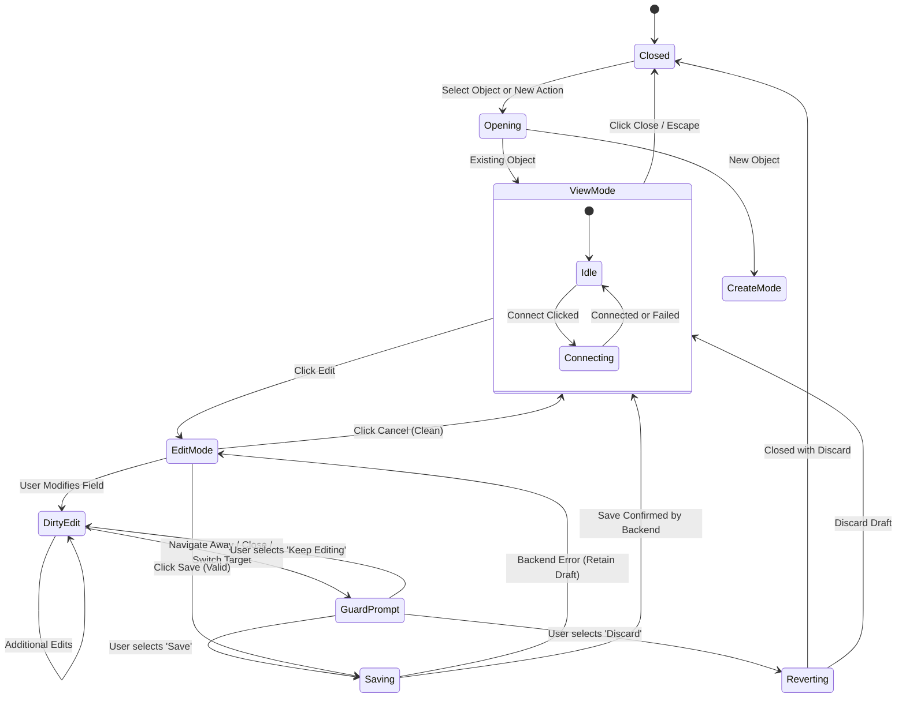

# Shellumi UI/UX Architecture Specification

**Status:** Authoritative  
**Target Platform:** Native macOS / Linux / Windows desktop with GPUI (`gpui = "=0.2.2"`)  
**Design Paradigm:** Unified Right-Hand Inspector, Standardized Safety Alerts, Dedicated Page Workflows, and Compact Protocol Toolbars.

---

## 1. Architectural Invariants

1. **Single Inspector Coordinator Per Window:**
   Each application window contains at most **one** active Inspector owned by a window-local `InspectorCoordinator`. An inspector is a single cohesive surface with a sticky header, independently scrollable body, and fixed action footer. Navigating between objects (e.g. from a group to a host) **replaces** the inspector content; multiple inspectors are never stacked or appended side-by-side.

2. **Routine CRUD & Configuration Surface:**
   All routine viewing, creation, editing, and configuration of core objects (Hosts, Groups, Identities, Snippets, Tunnels, Workspaces, Vault details, Cloud Providers, Team Members, and Remote Session Settings) use the shared `InspectorShell`. Bespoke floating editor dialogs for routine CRUD are eliminated.

3. **Guarded Draft Transitions (Zero Data Loss):**
   Unsaved form changes are strictly guarded. Attempting to select another object, switch navigation tabs, change active vaults, or close the window triggers a standard `Save / Discard / Keep Editing` confirmation guard. Draft states are preserved during window resizes and transient errors.

4. **Multi-Vault & Window Isolation:**
   The active inspector belongs exclusively to its window and active `VaultId`. Switching vaults cancels or guards pending drafts without leaking data across vaults. Asynchronous backend operations use generation tokens and target IDs to prevent delayed responses from mutating different objects or wrong vaults.

5. **Responsive Measured Layout Engine:**
   Layout transitions are based on actual measured GPUI content bounds, not screen resolution.
   - **Preferred Inspector Width:** 380–420 logical px (minimum 320 px, maximum 440 px).
   - **Side Presentation Mode:** Enabled only when the remaining primary content width is **>= 560 logical px**.
   - **Focused Content Presentation Mode:** When remaining primary content would drop below 560 logical px, the inspector smoothly transitions to full center content presentation, providing an accessible Back/Close control while preserving the main navigation rail.

6. **Authentic Controls & No False Affordances:**
   Every visible UI element must either function, display an explicit disabled state with explanation, or be omitted. Unsupported protocol actions (e.g. RDP audio redirection on VNC sessions) are hidden or clearly marked unavailable.

7. **Compact Protocol-Aware Remote Toolbar:**
   Remote desktop (RDP/VNC) sessions utilize a compact single-row toolbar (40–48 logical px high). Telemetry (FPS, latency, throughput), diagnostic details, and peripheral redirection settings (audio, microphone, drives, clipboard) are organized into categorized dropdown menus and a unified Session Inspector.

8. **Mathematical Canvas Bounds & Pointer Translation:**
   Remote canvas interaction uses measured display bounds to map window pointer events to framebuffer coordinates, properly handling letterboxing, centering, clipping, panning in 100% zoom, and stretch modes.

9. **Crash-Safe Vault-Scoped Credentials & Session Keys:**
   Credential writes use a durable `credential_operations` journal (`Planned` -> `Staged` -> `Committed` -> `Completed` / `RetryPending`) with CSPRNG vault-scoped references and post-commit cleanup. Remote desktop async workers and resize timers bind to `RemoteSessionKey { tab_id, connection_generation }` rather than mutable tab indices.

---

## 2. Interaction Surface Taxonomy

All user interfaces across Shellumi fall strictly into four categorized surfaces:

```mermaid
graph TD
    UI[Shellumi UI Surfaces] --> INS[1. Unified Inspector]
    UI --> ALT[2. Standardized Safety Alert]
    UI --> DED[3. Dedicated Page Workflow]
    UI --> POP[4. Anchored Menu / Popover]

    INS --> INS_VIEW[View Mode: Semantic metadata & actions]
    INS --> INS_CREATE[Create Mode: Blank context-aware form]
    INS --> INS_EDIT[Edit Mode: Controlled validated draft]

    ALT --> ALT_DEL[Delete Confirmation]
    ALT --> ALT_GUARD[Unsaved Changes Guard]
    ALT --> ALT_AUTH[Vault Unlock & Master Password]
    ALT --> ALT_TOFU[Host Key Fingerprint Trust]

    DED --> DED_WIZ[Setup & Onboarding Wizard]
    DED --> DED_DIFF[Sync Conflict Split-Diff]
    DED --> DED_REC[Disaster Recovery & Restore]
    DED --> DED_DOC[System Diagnostics Doctor]
    DED --> DED_PLAY[Session Recording Player]

    POP --> POP_ACT[Object Action Menu ...]
    POP --> POP_PAL[Command Palette & Quick Connect]
    POP --> POP_DISP[Display & Keyboard Dropdowns]
```



### 2.1 The Unified Inspector (`InspectorShell`)
- **Structure:**
  - `InspectorHeader`: Object title, icon/badge, status indicator, action menu, and close/back button.
  - `InspectorBody`: Scrollable region (`flex_1`, `min_h_0`, `overflow_y_scroll`) containing structured `InspectorSection`s.
  - `InspectorFooter`: Sticky action bar containing primary (Save/Create/Connect) and secondary (Cancel/Back) actions, with validation messages and busy indicators.
- **Modes:** `View`, `Create`, `Edit`, `Pending`, `Error`.

### 2.2 Standardized Safety Alerts (`ConfirmationAlert` / `SecurityChallenge`)
Short-lived modal dialogs that trap focus and block background interaction for irreversible or cryptographic decisions:
- Deleting hosts, groups, vaults, or credentials.
- Guarding unsaved changes (`Save`, `Discard`, `Keep Editing`).
- Master passphrase entry and biometric unlock.
- SSH host-key verification and TOFU acceptance.

### 2.3 Dedicated Page Workflows
Complex, multi-step, or full-width tasks that require extensive real estate:
- Setup onboarding wizard (`/setup`)
- Sync conflict split diff review (`/sync/conflict`)
- Session replay player (`/sessions/replay`)
- Batch execution monitor (`/batch`)
- System diagnostics doctor (`/settings/diagnostics`)

### 2.4 Transient Anchored Popovers & Menus
Transient popups positioned relative to measured trigger elements:
- Context menus (`…`)
- Command palette (Cmd+K)
- Display settings dropdown (Fit / 100% / Fill)
- Virtual keyboard menus (Ctrl+Alt+Del, Win, Alt+Tab)

---

## 3. Single Inspector Coordinator State Machine



---

## 4. Responsive Layout Architecture

```text
+----------------------------------------------------------------------------------+
| Top Bar (Vault Selector, Quick Connect / Search, Session Tabs, Overflow Menu)    |
+----------+----------------------------------------------+------------------------+
| Nav Rail | Primary Workspace                            | Unified Inspector      |
|          | (Hosts Grid/List, SFTP Browser, Terminal,    | Preferred: 380-420px   |
|          |  or Remote Desktop Canvas)                   | Sticky Header          |
|          |                                              | Scrollable Body        |
|          | Width >= 560px required for Side mode        | Sticky Footer          |
+----------+----------------------------------------------+------------------------+
```

When total window width or available primary content width drops below the minimum constraint:
- Side mode is replaced with **Focused Content mode**.
- The Inspector occupies the center workspace, maintaining the global top bar and navigation rail.
- An accessible Back button in the Inspector header returns the user to the previous inventory view.

---

## 5. Remote Desktop Coordinate Mapping

Coordinate mapping converts measured window coordinates to native remote framebuffer coordinates:

```text
Pointer Event (Global Screen / Window)
         │
         ▼
[GPUI Content Bounds Subtraction]
         │
         ▼
Canvas-Local Coordinates (cx, cy)
         │
         ▼
[Letterbox Exclusion & Aspect Check]
         │
         ▼  (Outside render area? -> Reject)
[Scale & Offset Transform: Fit, Fill, 100% Pan]
         │
         ▼
Framebuffer Coordinates (fx, fy) -> Dispatched to Protocol Worker
```

---

## 6. Remediation Architecture Notes (2026-11-26)

- **Cross-Platform Window Chrome (`ui/window_chrome.rs`):** `shellumi_window_options` configures transparent titlebar + traffic lights (`14, 14`) on macOS and `WindowDecorations::Server` (`appears_transparent: false`) on Windows and Linux. Client-side fallback controls (`ChromeMode::ClientFallback`) are rendered *only* when a compositor forces `Decorations::Client`. `ChromeMetrics::from_window` drives `calculate_topbar_geometry_with_chrome`, and `window.on_window_should_close` routes OS close requests through `NavigationRequest::CloseWindow` (closing only that window via `window.remove_window()`).
- **Setup Wizard Exemption:** The existing first-run setup wizard (`ui/setup_wizard_modal.rs`, `actions/setup_wizard.rs`) is explicitly preserved unchanged in layout, navigation, and recovery behavior.
- **Capability-Driven Host & Identity Credentials:** `ProtocolCapabilities::for_protocol` in `shellumi-core` governs protocol-specific fields, identity compatibility (`is_auth_method_compatible`), default port transitions, and inline credential persistence (`SessionOnly`, `SaveForThisHost`, `SaveAsIdentity` via atomic `HostStore::save_host_with_identity_tx`).
- **Adding Hosts with Credentials (User Guide):**
  - *Existing Identity:* In Host Edit/Create -> **Auth**, select **Existing Identity** to pick from protocol-compatible identities in the current vault.
  - *Create Reusable Identity Inline:* Select **Enter Credentials** -> **Save as Identity**, enter credentials and an identity name, and click **Save**; both the identity and host are persisted atomically in the vault.
  - *Host-Only vs. Ask on Connect:* **Save for This Host** stores a vault-scoped credential reference for this host without cluttering the reusable identity list; **Ask on Connect** / **Session Only** prompts at connection time without storing secrets.
  - *Protocol-Specific Fields:* SSH/Mosh expose username, key/password/agent, jump host, and startup snippet; RDP exposes username, domain, display resolution, color depth, view-only, strict TLS, audio, and mic; VNC exposes optional username, password/no-auth, resolution, color depth, and view-only; Telnet warns on cleartext; Serial/Local hide remote network/credential tabs.
- **Atomic Sync Payloads & Connection Operation Authorization:**
  - `HostStore::save_host_with_identity_and_journal_tx_inner` (`shellumi-storage`) serializes `SyncIdentityPayload` (device-local secret refs stripped) and `SyncHostPayload` (including resolved `identity_id` and `identity_name`) *inside* the SQLite transaction after IDs are resolved, with `apply_change_item` resolving `identity_name` across devices. Standalone `save_identity_with_journal_tx` and `delete_identity_with_journal_tx` record identity sync mutations atomically when the active vault is remote.
  - `ConnectionOpRegistry` (`shellumi-app/src/connection.rs`) tracks async launches (`Pending` -> `Consumed`/`Canceled`/`Superseded`) and enforces atomic `authorize_and_consume_connection_op()` against vault switches/locks, host revisions, reconnects, and tab/window close.
- **Single RD Resize Coordinator & Centralized Layout Invalidation:**
  - `RdAutoResizeState` (`shellumi-app/src/main.rs`, `actions/remote_desktop.rs`) routes all `ResizeOrigin::{Automatic, Manual}` requests through a single coordinator enforcing at most one outstanding negotiation, conservative `last_confirmed` updates, and `cancel_automatic()` when `dynamic_resize_enabled` is toggled off.
  - `Shellumi::invalidate_layout()` advances `layout_epoch` and clears stale `rd_canvas_measurements` on window bounds/scale changes, sidebar collapse, inspector open/close/presentation/width changes, tab/page switches, fullscreen, and RD disconnect/reconnect (never unconditionally during `render`).
- **Mosh Askpass Error Propagation:** `build_mosh_terminal_command()` (`actions/terminal.rs`) propagates `askpass::environment(&plan)` failures instead of silently ignoring them, aborting Mosh launch with an actionable error.
