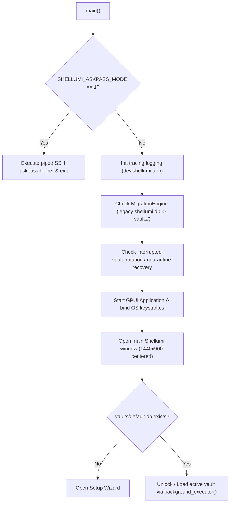

# Application Lifecycle

[Docs Home](../README.md) / [Architecture](README.md) / Application Lifecycle

---

## Startup Sequence (`crates/shellumi-app/src/main.rs`)

## Runtime Threading & Multi-Window Isolation

- **UI Thread (GPUI):** Renders views at 60/120 FPS. Database I/O, cryptography, and network operations never block the main UI thread.
- **Background Executors:** `cx.background_executor()` spawns async tasks running single-threaded or multi-threaded `tokio` runtimes (`features = ["rt", "rt-multi-thread"]`).
- **Multi-Window Vault Binding:** `open_vault_in_new_window` (`Cmd+Shift+N` / `Ctrl+Shift+N`) opens independent `Shellumi` root views in the same process, each bound to its own `active_vault_id`, host list, `InspectorCoordinator`, `ConnectionOpRegistry`, and WebSocket notification subscription.
