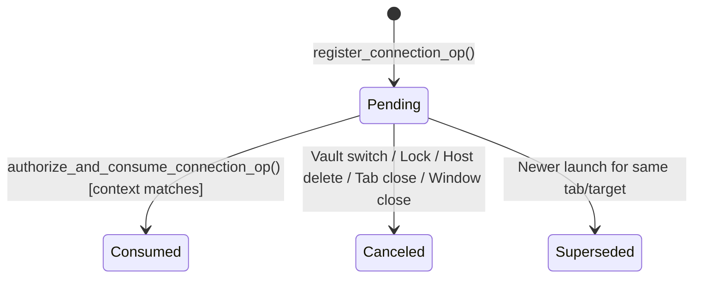

# Connection Engine & Authorization

[Docs Home](../README.md) / [Architecture](README.md) / Connection Engine

---

## Async Connection Authorization (`ConnectionOpRegistry`)

All asynchronous connection launches (SSH, SFTP, Mosh, Tunnels, RDP, VNC) are gated by `ConnectionOpRegistry` (`crates/shellumi-app/src/connection.rs`) to prevent stale async completions from mutating or connecting after context changes:

Every operation captures `vault_id`, `vault_load_generation`, `host_id`, `host_revision`, `tab_id`, and `connection_generation`. Before launching a PTY or protocol worker, `authorize_and_consume_connection_op()` atomically validates all fields and transitions `Pending` → `Consumed` once.

---

## Shared Auth Resolution & Askpass (`resolve_protocol_auth`)

1. `shellumi_storage::desktop::resolve_protocol_auth` resolves credentials in priority order:
   - Fail closed if `host.auth_dependency_unresolved` is `true`.
   - Saved `host.identity_id` (validated against `ProtocolCapabilities::is_auth_method_compatible`).
   - Host-specific credentials (`host_secret_ref`, `host_key_path`, `host_passphrase_ref`), or fail closed if `local_credentials_required == true` with no local secret.
   - Explicit `auth_mode` (`ask` or `no_auth` where `caps.allows_no_auth`).
   - Group inheritance (`group.identity_id`), failing closed if the group's identity dependency is unresolved.
2. For SSH, SFTP, Tunnels, and Mosh, secrets are never passed on command lines. Instead, `crates/shellumi-app/src/askpass.rs` configures `SSH_ASKPASS` pointing to the `shellumi-app` executable with `SHELLUMI_ASKPASS_MODE=1` and a scoped secret reference. Mosh (`build_mosh_terminal_command`) propagates askpass setup errors explicitly and aborts launch on failure.
