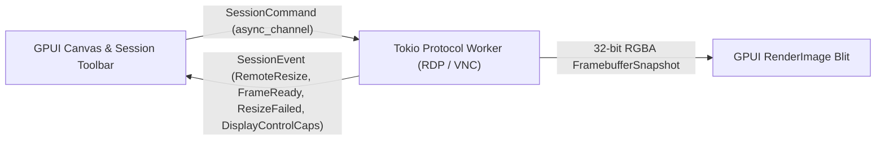
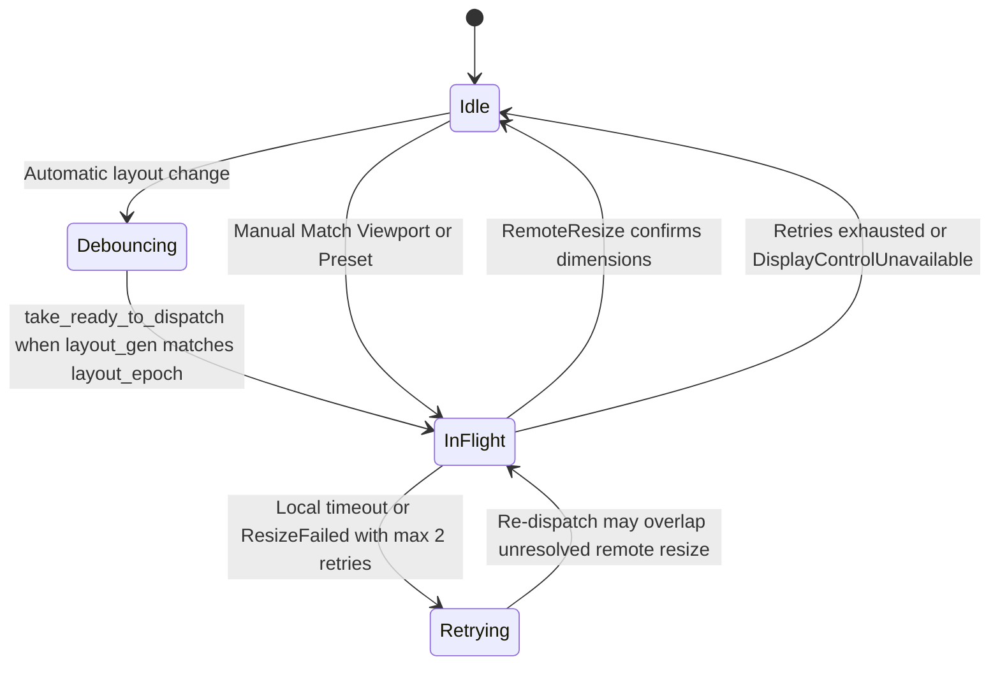
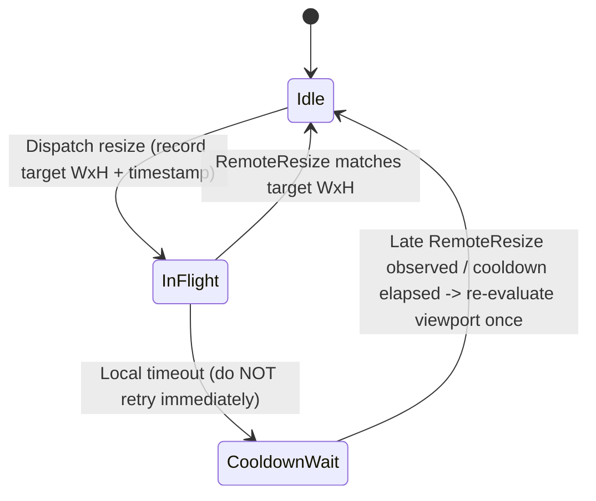

# Remote Desktop Engine (RDP & VNC)

[Docs Home](../README.md) / [Architecture](README.md) / Remote Desktop Engine

---

Shellumi's remote desktop subsystem is composed of three UI-independent protocol crates (`shellumi-remote-desktop`, `shellumi-vnc`, `shellumi-rdp`) driven by `shellumi-app` (`actions/remote_desktop.rs`, `ui/remote_desktop_canvas.rs`, `ui/remote_desktop_session.rs`).

## Protocol Backends & Worker Lifecycle

- **`shellumi-remote-desktop`:** Defines `SessionCommand`, `SessionEvent`, `FramebufferSnapshot`, `PanState`, `ReconnectPolicy`, and `SessionMetricsSnapshot`.
- **`shellumi-vnc`:** Pure-Rust RFB 3.3/3.7/3.8 client with VncAuth DES challenge-response, Raw/CopyRect/DesktopSize/Hextile/ZRLE/Tight decoders, decompression-bomb bounds, and clipboard sync.
- **`shellumi-rdp`:** Embedded `IronRDP` client with strict TLS/SHA-256 TOFU pinning, CredSSP/NLA, `MS-RDPEDISP` dynamic display control, `CLIPRDR` clipboard/file streaming, `RDPSND` (`cpal`) audio output, `RDPDR` local drive redirection, and `MS-RDPEAI` (`cpal`) microphone input.

---

## Measured Canvas Geometry & Input Mapping

- **Canvas Sensor:** `ui/remote_desktop_canvas.rs` wraps the canvas in a `gpui::canvas` bounds sensor tagged with `app.layout_epoch`, storing `CanvasMeasurement { tab_id, layout_epoch, viewport }` only when bounds change.
- **Coordinate Mapping (`CanvasTransform`):** Subtracts measured canvas origin, excludes letterbox/pillarbox margins in `Fit` mode, applies `PanState` offsets in `100% Actual Size` mode, and scales into remote framebuffer coordinates.

---

## Single Resize Coordinator & Timeout Limitations (`RD-001`)

`RdAutoResizeState` (`crates/shellumi-app/src/main.rs`) tracks **one local in-flight** `PendingResizeRequest` per `RemoteSessionKey { tab_id, connection_generation }`, but **cannot guarantee remote protocol-level serialization** across timeouts.

### Current Implemented Behavior

1. **Local In-Flight Tracking:** At most one `PendingResizeRequest` is marked `in_flight` locally; manual requests arriving mid-flight queue in `desired` rather than dispatching concurrently from the UI.
2. **No Per-Request Protocol Correlation:** `MS-RDPEDISP` / `ironrdp_displaycontrol` does **not** expose per-request acknowledgement correlation IDs or explicit resize-rejection PDUs.
3. **Worker Submission Failure vs. Server Rejection:** `SessionEvent::ResizeFailed` indicates local worker channel/submission failure (`input_sender.send`), not an authoritative server rejection PDU.
4. **Ambiguous Local Timeouts (`RD-001`):** A local timeout does **not** prove remote cancellation. Bounded retries (max 2) can overlap an unresolved server-side resize, and observed `RemoteResize` dimensions can be ambiguous when two requests targeted similar sizes.
5. **Layout-Generation & Cancellation Guards:** `Shellumi::invalidate_layout()` advances `layout_epoch` and bumps `debounce_generation`, while disabling auto-resize increments `auto_cancel_generation` so stale retries are dropped locally.
6. **Live Server Gap:** Live end-to-end resize acceptance against an external Windows RDP or `xrdp` server remains `NOT TESTED`.

### Proposed Safe Recovery Architecture (Proposed)

Under the proposed conservative recovery model (`RD-001`), an ambiguous timeout transitions to a `CooldownWait` state instead of issuing an overlapping retry, reconciling against the latest measured viewport only after the remote channel settles.
