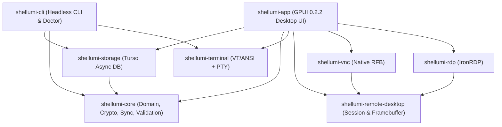

# Workspace and Crates

[Docs Home](../README.md) / [Architecture](README.md) / Workspace and Crates

---

Shellumi is organized as an **8-crate Cargo workspace** (Rust 2021 edition, `resolver = "2"`), with a strict separation between UI-independent domain/protocol crates and the GPUI desktop application.

## Crate Responsibilities

| Crate | Responsibilities | UI Dependency |
| :--- | :--- | :--- |
| **`shellumi-core`** | Domain models, `SshDestination`, `ProtocolCapabilities`, Argon2id/AES-256-GCM/X25519/Ed25519 crypto, `VaultCredentialStore` & OS backends, `sync` & `server` clients, `logging` | None |
| **`shellumi-terminal`** | VT/ANSI terminal emulator, OSC/scrollback handling, Asciicast v2 recording, cross-platform PTY (`portable-pty` / ConPTY) | None |
| **`shellumi-storage`** | Async Turso local encrypted databases (`vaults/*.db`), Schema 32 migrations, `MigrationEngine`, `vault_mutations`, `credential_operations`, `desktop::resolve_protocol_auth` | None |
| **`shellumi-remote-desktop`** | Protocol-neutral `SessionCommand`, `SessionEvent`, `FramebufferSnapshot`, `PanState`, `ReconnectPolicy` | None |
| **`shellumi-vnc`** | Native pure-Rust RFB 3.3/3.7/3.8 client, VncAuth DES, Raw/CopyRect/DesktopSize/Hextile/ZRLE/Tight decoders, clipboard | None |
| **`shellumi-rdp`** | Embedded `IronRDP` client, TLS TOFU pinning, `MS-RDPEDISP`, `CLIPRDR`, `RDPSND` (`cpal`), `RDPDR`, `MS-RDPEAI` | None |
| **`shellumi-cli`** | Headless host/identity/vault/sftp/snippet/team/infra CLI, `doctor`, `bench`, `keygen` | None |
| **`shellumi-app`** | GPUI `0.2.2` desktop application, Unified Inspector, `ConnectionOpRegistry`, `RdAutoResizeState`, SFTP browser, Askpass mode | GPUI `0.2.2` |

> [!NOTE]
> `Cargo.toml` also patches `xattr` via `vendor/xattr` (excluded from workspace members) for offline/reproducible builds.
