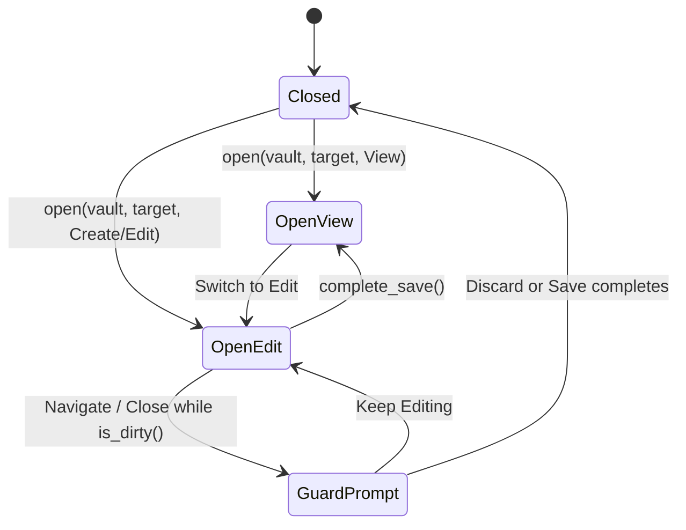

# Unified Inspector Specification

[Docs Home](../README.md) / [Design](README.md) / Unified Inspector

---

`InspectorCoordinator` (`crates/shellumi-app/src/ui/inspector/coordinator.rs`) is the single authoritative state machine for viewing, creating, and editing objects across Shellumi.

## Mandatory Invariants

1. **At Most One Inspector Per Window:** Opening a new target replaces the active inspector; panels never stack.
2. **Presentations:** Uses `Side` (right split pane, preferred `380–420px`) when primary content width >= `560px`, switching automatically to `FocusedContent` (with sticky `← Back` bar) on narrow viewports.
3. **10 Supported Targets:** `Host`, `Group`, `Identity`, `Snippet`, `Tunnel`, `Workspace`, `Vault`, `Provider`, `TeamMember`, and `Session` (live remote desktop telemetry).
4. **Dirty-State Navigation Guards:** Switching host, tab, page, vault, or closing the window while dirty prompts `Save`, `Discard`, or `Keep Editing` (`NavigationRequest`).
5. **Async Generation & Multi-Vault Isolation:** `start_save()` / `complete_save()` bind operations to `(vault_id, generation)` so stale async responses from a previous vault or target never mutate current state.
6. **Inline Identity Creation:** Host Edit/Create allows selecting an existing identity, storing host-private credentials, or creating a reusable identity inline (`Save as Identity`) atomically.
