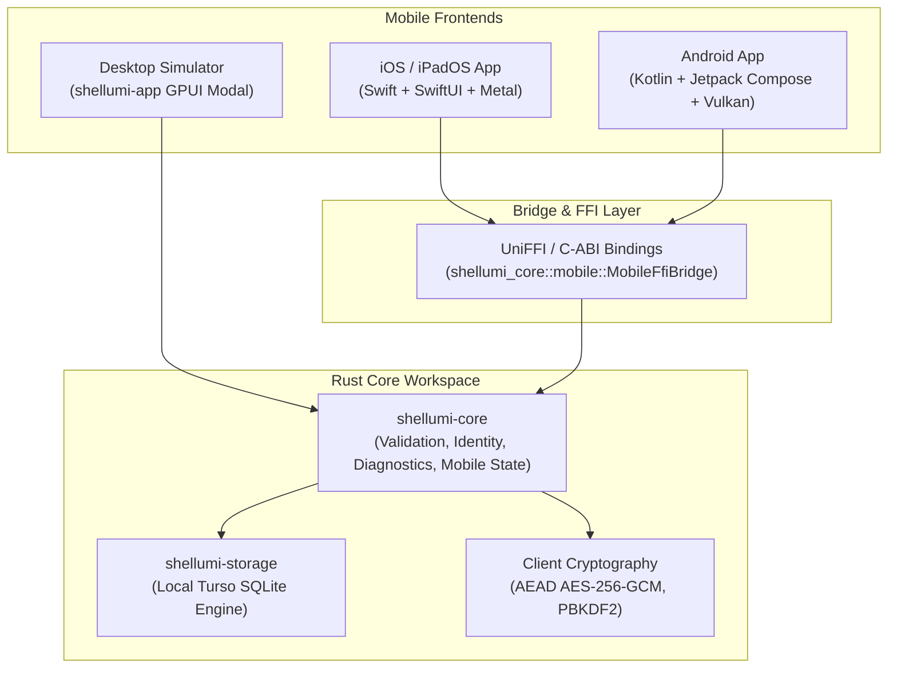
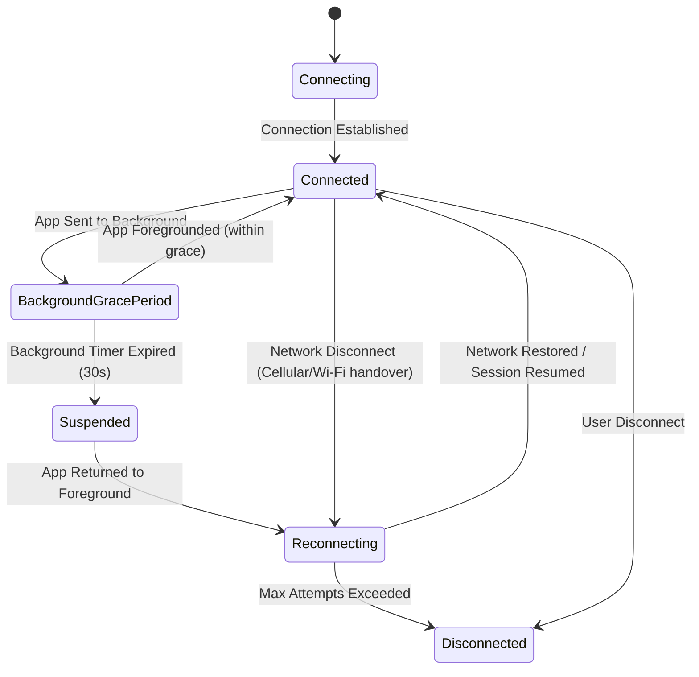

# Mobile Feasibility Assessment & Architecture Report (Phase 11)

This document provides a comprehensive technical assessment and architectural roadmap for extending Shellumi to mobile platforms (iOS, iPadOS, and Android), fulfilling the requirements of **Phase 11 — Mobile Feasibility and Development** from [PROJECT.md](../../PROJECT.md).

---

## 1. Executive Summary & Strategic Conclusion

| Dimension | Evaluation | Strategic Determination |
| :--- | :--- | :--- |
| **GPUI on Mobile** | 🔴 Not production-ready | Upstream GPUI 0.2.2 is exclusively tailored for desktop environments (macOS Metal, Linux Wayland/X11, Windows DirectX/DirectWrite). It lacks iOS UIKit / Android NDK windowing, touch event dispatching, and soft-keyboard input method editors (IMEs). |
| **Rust Core Portability** | 🟢 Fully portable & decoupled | `shellumi-core` has zero GUI and zero OS-dependent I/O dependencies. It compiles cleanly to `aarch64-apple-ios`, `aarch64-apple-ios-sim`, and `aarch64-linux-android`. |
| **Recommended Architecture** | 🟢 Decoupled Native Frontends | Maintain `shellumi-core` as the unified cross-platform engine. Deliver native platform frontends using **Swift/SwiftUI** on iOS/iPadOS and **Kotlin/Jetpack Compose** on Android via UniFFI or C-ABI bindings. |

> [!IMPORTANT]
> **Core Mandate from PROJECT.md:**
> *"If GPUI cannot currently provide a production-quality mobile UI, isolate the Rust core for a future mobile frontend. Do not compromise the desktop implementation merely to claim premature mobile support."*

---

## 2. Upstream GPUI Mobile Framework Analysis

### 2.1 Windowing & Surface Management
Desktop GPUI initializes window surfaces via macOS Cocoa (`NSWindow`, `CAMetalLayer`), Linux X11/Wayland (`winit`), and Windows Win32. On mobile:
- **iOS:** Requires `UIKit` windowing, `UIWindowSceneDelegate`, and `CAMetalLayer` bound to `UIViewController`. Touch hit-testing differs fundamentally from desktop mouse cursor coordinates.
- **Android:** Requires Android NDK `ANativeWindow`, JNI bindings to `android.view.SurfaceView`, and EGL/Vulkan context initialization.
- **Upstream Trajectory:** Upstream Zed Industries has initiated experimental research into mobile windowing, but has not released a stable, production-grade mobile backend for GPUI.

### 2.2 Touch Events & Virtual Soft Keyboards
Terminal emulation requires fine-grained character streaming, modifier key combinations (`Ctrl`, `Alt`), and escape sequences (`Esc`, `Tab`, arrows):
- Mobile operating systems display dynamic software keyboards that obscure 40%–50% of the viewport.
- GPUI currently lacks native virtual keyboard event listening (`UIKeyboardWillShowNotification`, `WindowInsetsCompat.ime()`), layout restructuring when soft keyboards open, and candidate bar integration.

---

## 3. Portable Core Engine (`shellumi-core::mobile`)

To enable native mobile clients without compromising the desktop application, Shellumi provides a headless, portable mobile subsystem in [`crates/shellumi-core/src/mobile.rs`](../../crates/shellumi-core/src/mobile.rs):



### 3.1 Mobile Bridge Capabilities
- **Destination Validation:** JSON-serialized target parsing (`MobileFfiBridge::parse_destination_json`) validating IPv4/IPv6, hostnames, usernames, and ports without shell evaluation.
- **Virtual Key Translation:** Translates touch actions into ANSI/VT escape byte arrays (`MobileFfiBridge::translate_virtual_key_json`).
- **Cryptographic Key Generation:** Generates hardware-compatible Ed25519 keypairs and SHA-256 fingerprints (`MobileFfiBridge::generate_keypair_json`) wiping private key material on drop.
- **System Health Diagnostics:** Serializes cross-platform cryptographic and storage checks into JSON reports for native health dashboards.

---

## 4. Mobile Touch Ergonomics & Virtual Accessory Bar

Standard mobile keyboards lack essential terminal keys. Shellumi provides the [`VirtualAccessoryBar`](../../crates/shellumi-core/src/mobile.rs) model, positioning an accessory row above the virtual keyboard:

### 4.1 Key Matrix and ANSI Translations

| Virtual Key | Touch Label | Generated Byte Sequence | Hex Code | Purpose |
| :--- | :--- | :--- | :--- | :--- |
| `Escape` | `Esc` | `\x1B` | `1B` | Mode switching (Vim, vi, dialogs) |
| `Tab` | `Tab` | `\x09` | `09` | Shell auto-completion |
| `ControlKey('c')` | `^C` | `\x03` | `03` | SIGINT interrupt signal |
| `ControlKey('z')` | `^Z` | `\x1A` | `1A` | SIGTSTP suspend signal |
| `ControlKey('d')` | `^D` | `\x04` | `04` | EOF / logout signal |
| `ArrowUp` | `↑` | `\x1B[A` | `1B 5B 41` | History navigation |
| `ArrowDown` | `↓` | `\x1B[B` | `1B 5B 42` | History navigation |
| `ArrowLeft` | `←` | `\x1B[D` | `1B 5B 44` | Cursor backward |
| `ArrowRight` | `→` | `\x1B[C` | `1B 5B 43` | Cursor forward |
| `Pipe` | `\|` | `\|` | `7C` | Command piping |
| `Tilde` | `~` | `~` | `7E` | Home directory / path expansion |
| `Home` | `Home` | `\x1B[H` | `1B 5B 48` | Jump to beginning of line |
| `End` | `End` | `\x1B[F` | `1B 5B 46` | Jump to end of line |
| `PageUp` | `PgUp` | `\x1B[5~` | `1B 5B 35 7E` | Scroll view upward |
| `PageDown` | `PgDn` | `\x1B[6~` | `1B 5B 36 7E` | Scroll view downward |

### 4.2 Sticky Modifier Key Semantics
The accessory bar supports sticky `Ctrl` and `Alt` modifiers:
1. User taps `[Ctrl]`: the button highlights in amber (`VirtualKeyModifier::Ctrl`).
2. User taps any key (e.g. `x`): [`VirtualAccessoryBar::resolve_char_keystroke`](../../crates/shellumi-core/src/mobile.rs) computes byte `0x18` (Ctrl-X) and immediately clears the sticky flag.

---

## 5. Mobile OS Lifecycle & Connection Resilience

Mobile operating systems aggressively suspend background applications to preserve battery and memory.



### 5.1 Platform Restrictions

| Operating System | Background Socket Policy | Shellumi Strategy |
| :--- | :--- | :--- |
| **iOS / iPadOS** | Background sockets severed after ~30 seconds (`beginBackgroundTaskWithExpirationHandler`). Direct TCP keepalive impossible in background. | Transition to `BackgroundGracePeriod (30s)`; gracefully snapshot screen buffer on expiration; execute exponential reconnect backoff upon foregrounding. For Mosh connections, session UDP state roams seamlessly without TCP renegotiation. |
| **Android** | Background execution halted by Doze mode unless bound to a running Foreground Service. | Implement `ForegroundService` with persistent status notification (`Active SSH session to <host>`), maintaining PTY sockets while session is running. |

---

## 6. Hardware-Backed Biometric Credential Architecture

Mobile credentials must never be stored in plain files or unencrypted SQLite databases. [`MobileCredentialSpec`](../../crates/shellumi-core/src/mobile.rs) defines hardware-enforced storage models:

### 6.1 iOS Keychain & Secure Enclave
- **Storage Class:** `kSecClassGenericPassword` with service identifier `org.shellumi.app`.
- **Biometric Enforcement:** `kSecAccessControlBiometryAny | kSecAttrAccessibleWhenUnlockedThisDeviceOnly`.
- **Authentication Flow:** User unlock prompts native `LocalAuthentication` (`LAContext`), requesting Face ID or Touch ID. Upon cryptographic assertion from the Secure Enclave, private keys or vault master keys are decrypted directly in memory.

### 6.2 Android Keystore Provider
- **Algorithm:** AES-256-GCM master key generated in hardware-backed Trusted Execution Environment (TEE) or StrongBox.
- **Biometric Enforcement:** `KeyGenParameterSpec.Builder` with `setUserAuthenticationRequired(true)` and `AUTH_BIOMETRIC_STRONG`.
- **Authentication Flow:** Android `BiometricPrompt` authenticates biometric biometric signature before granting cryptographic cipher access.

---

## 7. Desktop Simulation & CLI Verification Tools

To validate mobile ergonomics without requiring physical phones during development:

1. **Desktop GPUI Simulator Modal ([`shellumi-app`](../../crates/shellumi-app)):**
   - Click `[📱 Mobile Sim]` in the top toolbar or press `Cmd+Alt+M` in the Command Palette.
   - Select device presets: iPhone 15 Pro (393 × 852), Pixel 8 (412 × 924), or iPad Pro 11" (834 × 1194).
   - Test touch virtual keys (`Esc`, `Tab`, `^C`, `^Z`, arrows) and observe translated ANSI/VT byte streams in real time.
   - Simulate mobile OS lifecycle events (`📱 Background (30s)`, `⏱ Tick 10s`, `⏳ Expire`, `📶 Drop Net`, `🔄 Reconnect`, `☀️ Foreground`).

2. **CLI Testing Commands ([`shellumi-cli`](../../crates/shellumi-cli)):**
   - Inspect virtual key translations:
     ```sh
     cargo run -p shellumi-cli -- mobile virtual-keys
     ```
   - Simulate lifecycle state transitions:
     ```sh
     cargo run -p shellumi-cli -- mobile lifecycle-sim background
     ```
   - Verify FFI bridge serialization:
     ```sh
     cargo run -p shellumi-cli -- mobile ffi-check
     ```

---

## 8. Implementation Roadmap for Native Mobile Frontends

```text
Phase 11 (Completed): Feasibility, portable core models, virtual accessory engine, lifecycle state machines, desktop simulator modal, and documentation.
Phase 11.1 (Next): UniFFI Rust crate (shellumi-mobile-ffi) generating Swift and Kotlin bindings.
Phase 11.2: Native iOS/iPadOS Xcode project (SwiftUI + Swift Terminal View + iOS Keychain).
Phase 11.3: Native Android Android Studio project (Jetpack Compose + Android Keystore + ForegroundService).
```
