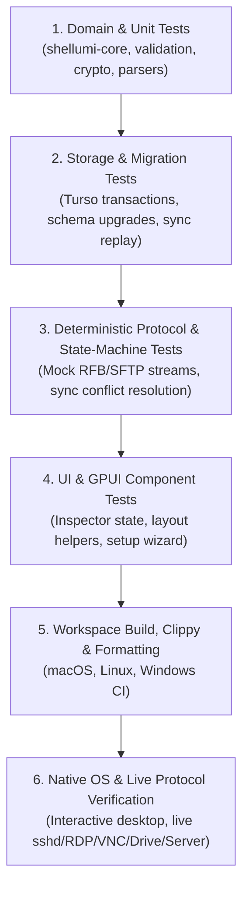

[Documentation Home](../README.md) > [QA](README.md) > **Test Strategy**

# Test Strategy

Shellumi uses a layered testing model designed to catch domain, storage, protocol, security, and UI regressions without relying on fragile end-to-end mocks.

## Testing Layers

### 1. Domain & Unit Tests (`shellumi-core`, `shellumi-terminal`)
- Host/port/IPv6/destination validation and shell-injection rejection.
- Credential store abstractions, encrypted-file fallback, and Argon2id/AES-256-GCM key derivation.
- Terminal VT/ANSI parsing, resize invariants, and SFTP path handling.

### 2. Storage & Migration Tests (`shellumi-storage`)
- Atomic SQLite/Turso migration transactions and schema version rejection for future schemas.
- Database reopen persistence across restarts.
- Atomic host + identity + credential-operation-journal + sync-mutation transactions.
- Cross-device sync replay, object-identifier mapping, and conflict resolution.

### 3. Deterministic Protocol & State-Machine Tests
- **SFTP:** Cross-platform loopback TCP transport tests for SFTP handshake, directory listing, and remote editor dirty-tracking/save (`crates/shellumi-core/src/sftp/tests.rs`).
- **VNC (`shellumi-vnc`):** Mock RFB server and malformed-packet fuzz/edge-case decoding tests.
- **RDP (`shellumi-rdp`):** Framebuffer state transitions, reconnect/error handling, and input mapping tests.

### 4. UI & GPUI Component Tests (`shellumi-app`)
- Setup wizard state machine and storage integration (`crates/shellumi-app/tests/setup_wizard.rs`).
- Data conversion helpers, Inspector selection/draft persistence, and responsive layout breakpoint logic.

### 5. Workspace CI Gates (`.github/workflows/ci.yml`)
- `cargo fmt --all -- --check`
- `cargo clippy --workspace --all-targets -- -D warnings`
- `cargo test --workspace` on `macos-latest`, `ubuntu-latest`, and `windows-latest`.

### 6. Native OS & Live Protocol Verification
- Interactive GUI verification, OS keychain/credential-manager prompts, windowing/DPI scaling, and live server handshakes. See [Native Testing](native-testing.md) and [Protocol Testing](protocol-testing.md).

## Running Tests Locally

See [Testing Guide](../development/testing.md) for exact `cargo test --offline` commands per crate.
