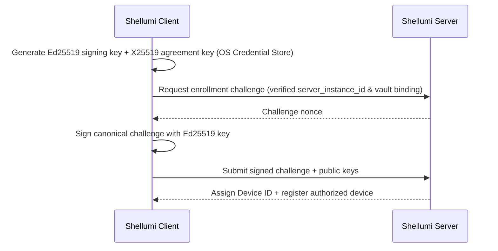

#  Device Enrollment & Trust Lifecycle

[Docs Home](../README.md) / [Synchronization](README.md) / Device Enrollment

---

Shellumi Server vaults require explicit cryptographic device enrollment per server connection:

- **Key Generation & Storage:** Generates an Ed25519 signing keypair and X25519 key-agreement keypair; private keys are persisted in the OS credential store under `keychain://org.shellumi.server/...` references.
- **Crash-Safe Enrollment Journal (Schema 28–30):** Records intended public keys and credential-store references before registration (`RegistrationPrepared`), enabling restart recovery via authoritative server account/recipient listings without replaying duplicate registrations.
- **Device Replacement & Revocation:** Replacing keys verifies local vault authorization, active account registration, and vault recipient listings before authorizing the new device and offering confirmed global revocation of the old device.
- **Invitations:** Acceptance binds the selected vault, server instance UUID, endpoint, and authenticated user; invitation tokens stay in zeroizing memory only.
