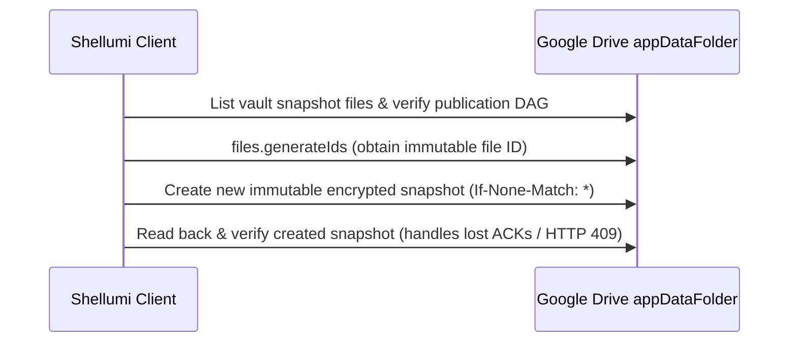

#  Google Drive Synchronization

[Docs Home](../README.md) / [Synchronization](README.md) / Google Drive Sync

---

Shellumi's optional Google Drive integration synchronizes personal vaults end-to-end encrypted inside the restricted `https://www.googleapis.com/auth/drive.appdata` folder. Google never receives plaintext records, DEKs, passwords, or device-local Keychain references.

---

## OAuth 2.0 PKCE & Configuration

- **Protocol:** OAuth 2.0 Authorization Code Flow with PKCE (`RFC 7636`, 32-byte random verifier, SHA-256 challenge) and loopback callback (`OAuthCallbackListener` on `127.0.0.1`).
- **Required Settings:**
  - Explicit vault opt-in in **Settings → Synchronization** (stored in the encrypted default registry).
  - Google OAuth Client ID (`SHELLUMI_GOOGLE_CLIENT_ID` when configuring OAuth) and valid OAuth token (`OAuthTokenBundle` in credential store or `SHELLUMI_GDRIVE_TOKEN` for CLI/automation).
  - Vault passphrase (`SHELLUMI_VAULT_PASSPHRASE` for CLI/background sync).
- **Transport:** Uses `SystemHttpTransport` (`curl` subprocess with stdin headers/body to avoid exposing bearer tokens in `ps` arguments).

---

## Authenticated Revision Protocol & Cryptography

- **AEAD Envelopes:** Published records are encrypted with AES-256-GCM under the vault DEK, with AAD bound to vault, entity type, and object ID.
- **Authenticated `cloud_state` DAG (v1):** Independent `key` and `metadata` histories bind protocol version, vault ID, component name, generation, sorted parent IDs, and SHA-256 content hash with HMAC-SHA-256 under the vault DEK.
- **Create-Only Optimistic Concurrency:** Every update creates a brand-new immutable file via `files.generateIds`; existing cloud objects are never patched or overwritten. Lost acknowledgments are accepted only after exact read-back.
- **Default Vault Isolation:** The default vault (`legacy-local`) synchronizes only encrypted directory discovery metadata (`SyncVault.encrypted_directory`), never local host credentials or secondary vault DEKs.

---

## Password Rotation, Recovery & Current Limitations

- **Password Rotation:** Re-wraps the DEK in `VaultManifest` and appends a signed node to `key` history; historical cloud snapshots remain readable by the DEK they were sealed under, so password rotation does not revoke previously disclosed DEKs or historic backups.
- **No Automatic Cloud Pruning:** Immutable snapshots accumulate on Drive; no automatic pruning is implemented.
- **Device ID Fallback:** When `SHELLUMI_DEVICE_ID` is unset, desktop Drive sync currently falls back to `"desktop-app"` (see [Object Identifiers](object-identifiers.md)).
- **Verification Scope:** Automated tests verify create-only concurrency, HTTP 409 read-back, tampered DAG rejection, and second-device restoration against a controlled HTTP fixture; live Google Drive account acceptance remains separate (`NOT TESTED`).
