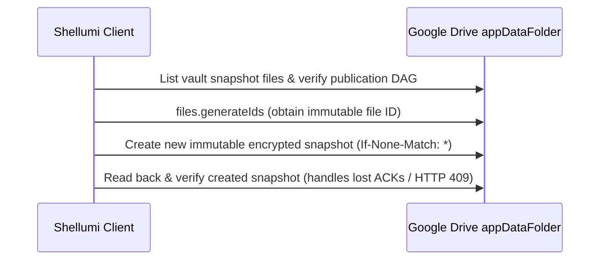

#  Google Drive Synchronization

[Docs Home](../README.md) / [Synchronization](README.md) / Google Drive Sync

---

Shellumi's optional Google Drive integration synchronizes personal vaults end-to-end encrypted inside the restricted `https://www.googleapis.com/auth/drive.appdata` folder. Google never receives **plaintext** vault records, plaintext DEKs, or plaintext passwords.

> [!IMPORTANT]
> **Encryption vs. Device-Local Metadata (`SYNC-004`, `SYNC-005`):**
> End-to-end encryption protects payload confidentiality against Google, but **does not mean device-local metadata has been stripped from every encrypted payload**. Specifically, the current full-vault export path (`export_vault`) serializes `protocol_config` inside the encrypted payload, which can include device-local `keychain://` credential references. See [Known Issues](../project/known-issues.md) for `SYNC-004`, `SYNC-005`, and `SYNC-006`.

## Payload & Data Classification

| Artifact / Mechanism | Plaintext Secrets | Encrypted Secret Material | Device-Local Credential Refs (`keychain://`) | Portable Auth Metadata |
| --- | --- | --- | --- | --- |
| **Google Drive Incremental / Snapshot Sync** | Never | Encrypted under vault DEK (`AES-256-GCM`) | May appear in serialized `protocol_config` if exported via full-vault path (`SYNC-004`) | Auth method, username, key/cert metadata |
| **Shellumi Server Incremental Sync** | Never | Encrypted under vault DEK (`aes256gcm_dek_v1`) | Filtered/reconciled on `merge_synced_protocol_config` (`SYNC-005` cleanup pending) | `sync_id`, `identity_sync_id`, auth method |
| **Full-Vault Export / Encrypted Backup** | Never | Encrypted with Argon2id + AES-256-GCM | Currently included inside encrypted `protocol_config` (`SYNC-004`) | Host/group/identity records |
| **Google Drive Restoration** | Never | Decrypted locally with vault passphrase/DEK | Device-local refs from another machine will not resolve locally | Restores portable records; local keychain refs require re-binding |

---

## OAuth 2.0 PKCE & Configuration

- **Protocol:** OAuth 2.0 Authorization Code Flow with PKCE (`RFC 7636`, 32-byte random verifier, SHA-256 challenge) and cancellable loopback callback (`OAuthCallbackListener::wait_for_code_cancellable` on `127.0.0.1`).
- **Configuration Precedence (`resolve_google_oauth_config`):**
  1. **Advanced Developer / Self-Build Override:** Optional explicit Client ID (and optional Client Secret) entered in the Setup Wizard or Settings.
  2. **Packaged Release Configuration:** Build-time `SHELLUMI_GOOGLE_OAUTH_CLIENT_ID` (and optional `SHELLUMI_GOOGLE_OAUTH_CLIENT_SECRET`) injected by `.github/workflows/release.yml` via `option_env!`.
  3. **Development Environment Variable:** `SHELLUMI_GOOGLE_CLIENT_ID` (and optional `SHELLUMI_GOOGLE_CLIENT_SECRET`).
  4. **Credential Store:** Account-scoped Client ID persisted in the OS credential store.
  - Placeholder IDs (such as `shellumi-desktop`) are rejected. Unconfigured self-builds remain fully functional local-first and surface an **Advanced OAuth Configuration** panel rather than failing silently.
- **Required Settings:**
  - Explicit vault opt-in in **Settings → Synchronization** or Setup Wizard (stored in the encrypted default registry).
  - Valid OAuth token (`OAuthTokenBundle` in OS credential store or `SHELLUMI_GDRIVE_TOKEN` for CLI/automation).
  - Vault passphrase (`SHELLUMI_VAULT_PASSPHRASE` for CLI/background sync).
- **Transport:** Uses `SystemHttpTransport` (`curl` subprocess with stdin headers/body to avoid exposing bearer tokens in `ps` arguments).

---

## Authenticated Revision Protocol & Cryptography

- **AEAD Envelopes:** Published records are encrypted with `AES-256-GCM` under the vault DEK, with AAD bound to vault, entity type, and object ID.
- **Authenticated `cloud_state` DAG (v1):** Independent `key` and `metadata` histories bind protocol version, vault ID, component name, generation, sorted parent IDs, and SHA-256 content hash with `HMAC-SHA-256` under the vault DEK.
- **Create-Only Optimistic Concurrency:** Every update creates a brand-new immutable file via `files.generateIds`; existing cloud objects are never patched or overwritten. Lost acknowledgments are accepted only after exact read-back.
- **Default Vault Isolation:** The default vault (`legacy-local`) synchronizes only encrypted directory discovery metadata (`SyncVault.encrypted_directory`), never secondary vault DEKs.

---

## Password Rotation, Recovery & Current Limitations

- **Password Rotation:** Re-wraps the DEK in `VaultManifest` and appends a signed node to `key` history; historical cloud snapshots remain readable by the DEK they were sealed under, so password rotation does not revoke previously disclosed DEKs or historic backups.
- **No Automatic Cloud Pruning:** Immutable snapshots accumulate on Drive; no automatic pruning is implemented.
- **Device ID Fallback (`SYNC-006`):** When `SHELLUMI_DEVICE_ID` is unset, desktop Drive sync currently falls back to `"desktop-app"`.
- **Verification Scope:** Automated tests verify create-only concurrency, HTTP 409 read-back, tampered DAG rejection, and second-device restoration against a controlled HTTP fixture; live Google Drive account acceptance remains separate (`NOT TESTED`).
