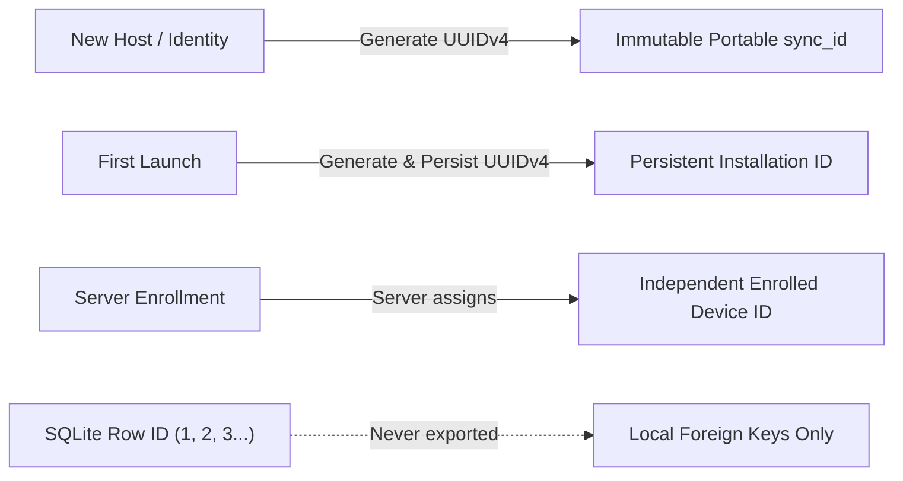

# Synchronization Object Identifiers

[Docs Home](../README.md) / [Synchronization](README.md) / Object Identifiers

---

## Identifier Taxonomy

| Identifier | Scope | Portability | Purpose |
| :--- | :--- | :--- | :--- |
| **Local database row ID** (`hosts.id`, `identities.id`) | Single local SQLite file | **Device-local only** | SQLite `AUTOINCREMENT` primary key; never trusted across devices |
| **Synchronization Object ID** (`sync_id` / `object_id`) | Cross-device within a vault | **Portable** | Identifies synchronized hosts and identities across renames and devices |
| **Local Installation ID** (`SHELLUMI_DEVICE_ID`) | Local client installation | **Device-local** | Identifies the originating client in Drive sync envelopes |
| **Shellumi Server Device ID** (`device_id`) | Server account / vault | **Server-assigned** | Identifies an enrolled Ed25519/X25519 device on Shellumi Server |
| **Local Vault ID** (`VaultId`) | Local vault registry & DB | **Device-local** | Selects `vaults/<vault-id>.db` and binds `keychain://` credential ownership |
| **Remote Vault ID** (`server_vault_id`) | Remote Shellumi Server | **Server-assigned** | Identifies the remote vault on a Shellumi Server instance |
| **Server Instance ID** (`server_instance_id`) | Remote Shellumi Server | **Server-assigned** | Prevents cross-server impersonation or endpoint confusion |
| **Account & Member IDs** | Remote Shellumi Server | **Server-assigned** | Identifies authenticated server user and vault membership |
| **Connection & Operation IDs** (`op_id`, `operation_id`) | Single process / local journal | **Ephemeral / local** | Authorizes async connection launches (`ConnectionOpRegistry`) and journaled credential ops |

---

## Current Implementation vs. Known Issues

> [!WARNING]
> **Current Implementation Status (Baseline `3123db2`):** Schema 32 introduced `sync_id` columns on `identities` and `hosts`, removed foreign numeric `identity_id` fallbacks, and added `auth_dependency_unresolved` tracking. However, the following six identifier/sync issues remain open in the current codebase:

1. **Schema-32 backfill derives `sync_id` from local row IDs:** Existing rows backfilled during migration 31→32 use `vault_id || ':identity:' || id` and `vault_id || ':host:' || id`, which can collide across independent devices that created pre-Schema-32 records with matching local row IDs.
2. **Incoming host sync name fallback:** `server_sync::apply_change_item` falls back to matching an existing local host by `name` if `sync_id` does not match, which can overwrite an unrelated local host with the same display name.
3. **Identity deletion side effect:** Deleting an identity triggers `ON DELETE SET NULL` on referencing hosts; if those hosts also have `auth_mode = 'inherit_group'` or no explicit block, effective authentication behavior can fall back unexpectedly instead of remaining explicitly blocked.
4. **Full vault export/import (`export_vault` / `import_vault`):** Full encrypted vault export in `shellumi-storage/src/lib.rs` still constructs `SyncHostPayload` / `SyncIdentityPayload` with `sync_id: None`, `identity_sync_id: None`, and `identity_name: None` rather than stable synchronization associations.
5. **Incoming credential cleanup vs. journal:** When incoming host sync invalidates incompatible local credential references (`merge_synced_protocol_config`), it removes them from `protocol_config` without staging/committing an explicit `credential_operations` journal cleanup entry for the orphaned OS secret.
6. **Google Drive shared fallback Device ID:** Desktop Google Drive sync (`actions/sync.rs`) falls back to the static string `"desktop-app"` when `SHELLUMI_DEVICE_ID` is unset.

---

## Recommended Target Architecture (Proposed)

- Use cryptographically random immutable UUIDv4s for all newly created synchronization objects and full-vault exports.
- Migrate pre-Schema-32 rows based on verified synchronization provenance rather than local row IDs.
- Generate and persist a random installation UUID for Google Drive sync instead of `"desktop-app"`.
- Route incoming incompatible credential invalidations through `credential_operations` cleanup.
