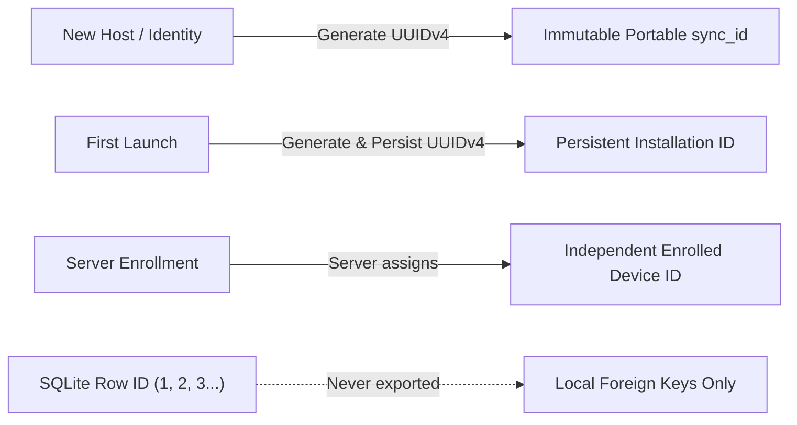

# Synchronization Object Identifiers

[Docs Home](../README.md) / [Synchronization](README.md) / Object Identifiers

---

## Identifier Taxonomy

| Identifier | Scope | Portability | Purpose |
| :--- | :--- | :--- | :--- |
| **Local database row ID** (`hosts.id`, `identities.id`) | Single local SQLite file | **Device-local only** | SQLite `AUTOINCREMENT` primary key; never trusted across devices |
| **Synchronization Object ID** (`sync_id` / `object_id`) | Cross-device within a vault | **Portable** | Identifies synchronized hosts and identities across renames and devices |
| **Local Installation ID** (`SHELLUMI_DEVICE_ID`) | Local client installation | **Device-local** | Identifies the originating client in Drive sync envelopes |
| **Shellumi Server Device ID** (`device_id`) | Server account / vault | **Server-assigned** | Identifies an enrolled Ed25519/X25519 device on Shellumi Server |
| **Local Vault ID** (`VaultId`) | Local vault registry & DB | **Device-local** | Selects `vaults/<vault-id>.db` and binds `keychain://` credential ownership |
| **Remote Vault ID** (`server_vault_id`) | Remote Shellumi Server | **Server-assigned** | Identifies the remote vault on a Shellumi Server instance |
| **Server Instance ID** (`server_instance_id`) | Remote Shellumi Server | **Server-assigned** | Prevents cross-server impersonation or endpoint confusion |
| **Account & Member IDs** | Remote Shellumi Server | **Server-assigned** | Identifies authenticated server user and vault membership |
| **Connection & Operation IDs** (`op_id`, `operation_id`) | Single process / local journal | **Ephemeral / local** | Authorizes async connection launches (`ConnectionOpRegistry`) and journaled credential ops |

---

## Current Implementation vs. Known Issues

> [!WARNING]
> **Current Implementation Status (Baseline `7244263`):** Schema 32 introduced `sync_id` columns on `identities` and `hosts`, removed foreign numeric `identity_id` fallbacks, and added `auth_dependency_unresolved` tracking. Six confirmed identifier/sync defects remain open and are tracked canonically in [Known Issues](../project/known-issues.md):
>
> - [`SYNC-001`](../project/known-issues.md#sync-001--schema-32-migration-generates-synchronization-identifiers-from-local-row-ids) — Schema-32 backfill derives `sync_id` from local row IDs.
> - [`SYNC-002`](../project/known-issues.md#sync-002--incoming-host-synchronization-can-match-unrelated-hosts-by-name) — Incoming host sync name fallback in `server_sync::apply_change_item`.
> - [`SYNC-003`](../project/known-issues.md#sync-003--identity-deletion-can-unintentionally-change-effective-authentication) — Identity deletion `ON DELETE SET NULL` side effect.
> - [`SYNC-004`](../project/known-issues.md#sync-004--full-vault-exportimport-does-not-consistently-preserve-stable-object-associations) — Full vault export/import (`export_vault` / `import_vault`) omits `sync_id` and retains `protocol_config`.
> - [`SYNC-005`](../project/known-issues.md#sync-005--incoming-synchronization-bypasses-journaled-cleanup-of-incompatible-credentials) — Incoming credential invalidation bypasses `credential_operations` journal cleanup.
> - [`SYNC-006`](../project/known-issues.md#sync-006--google-drive-defaults-to-the-shared-installation-identifier-desktop-app) — Google Drive defaults to `"desktop-app"` when `SHELLUMI_DEVICE_ID` is unset.

---

## Recommended Target Architecture (Proposed)

- Use cryptographically random immutable UUIDv4s for all newly created synchronization objects and full-vault exports.
- Migrate pre-Schema-32 rows based on verified synchronization provenance rather than local row IDs.
- Generate and persist a random installation UUID for Google Drive sync instead of `"desktop-app"`.
- Route incoming incompatible credential invalidations through `credential_operations` cleanup.
