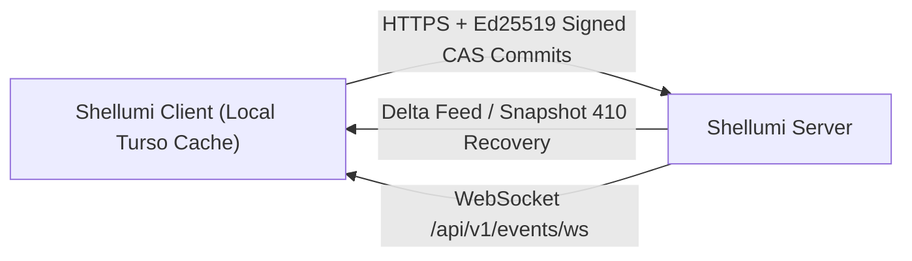

#  Shellumi Server Synchronization

[Docs Home](../README.md) / [Synchronization](README.md) / Shellumi Server

---

For self-hosted multi-device sync, shared team vaults, and encrypted terminal collaboration, Shellumi connects to [Shellumi Server](https://github.com/MJKhaani/Shellumi-Server). Server installation, database setup, and administration are documented in the Shellumi Server repository.

---

## Connection, Trust Boundary & Authentication

- **Configuration:** Server base URL, account credentials, and verified `server_instance_id` stored in `vault_server_connections` (`default.db`). Auth tokens, refresh tokens, and device private keys are stored in the OS credential store (`keychain://org.shellumi.server/...`).
- **Trust Boundary:** Vault record payloads are encrypted client-side (`aes256gcm_dek_v1`) before upload; the server stores ciphertext envelopes, signed CAS mutation metadata, and public device keys.
- **Portable Auth Boundary:** `SyncHostPayload` uses allowlisted `PortableProtocolSettings` and strips device-local secret references (`host_secret_ref`, `host_passphrase_ref`, `host_key_path`) and local identity key paths. Receiving devices retain valid local credentials and fail closed when `local_credentials_required` is set without local credentials.

---

## Synchronization & Offline Behavior

- **Offline-First Cache:** Each remote vault has an encrypted local SQLite database (`vaults/<vault-id>.db`) and `vault_mutations` outbox. Edits commit locally first and sync on reconnect.
- **CAS & Cursor Recovery:** Commits use Compare-And-Swap revisions and batch idempotency keys. Expired cursors (HTTP 410) trigger full snapshot recovery (`fetch_latest_snapshot`).
- **WebSocket Broker:** Subscribes to `/api/v1/events/ws` per vault-bound window and triggers REST delta reconciliation on change notifications.
- **Cross-Device Identity Association (Schema 32):** Incoming host/group mutations resolve identities strictly by immutable `sync_id` or unique legacy `identity_name` (never foreign numeric `identity_id`) and mark unresolved dependencies (`auth_dependency_unresolved = 1`) until the identity arrives.

> [!NOTE]
> Live server interoperability was exercised against controlled protocol/server fixtures in `shellumi-storage`; see [Known Limitations](../security/known-limitations.md) for remaining team epoch-key and server-transaction items.
