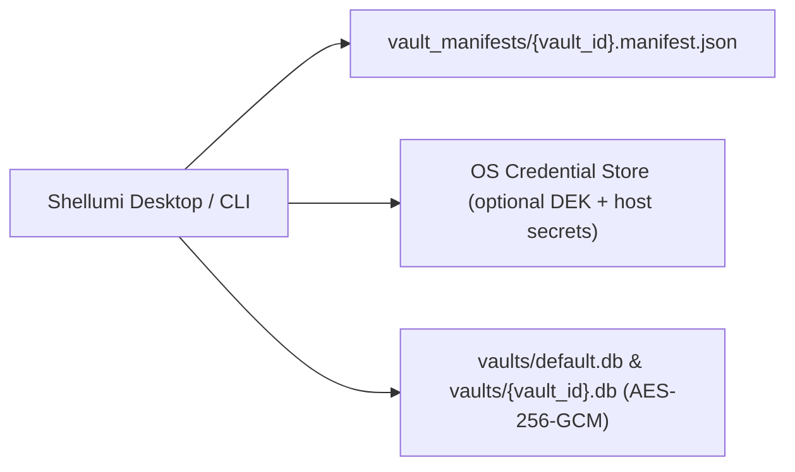

# Standalone Mode (Offline Local)

[Docs Home](../README.md) / [Synchronization](README.md) / Standalone Mode

---

In **Standalone Mode**, Shellumi operates 100% locally with zero cloud accounts, telemetry, or external network connections:

- **No Required External Configuration:** Only a master password (and optional OS Keychain storage) is needed.
- **Multi-Vault Support:** Create any number of isolated local secondary vaults (`vaults/<vault-id>.db`), each with its own DEK and recovery code.
- **Backups:** Export encrypted local snapshots at any time via Settings or `shellumi-cli vault export`.
